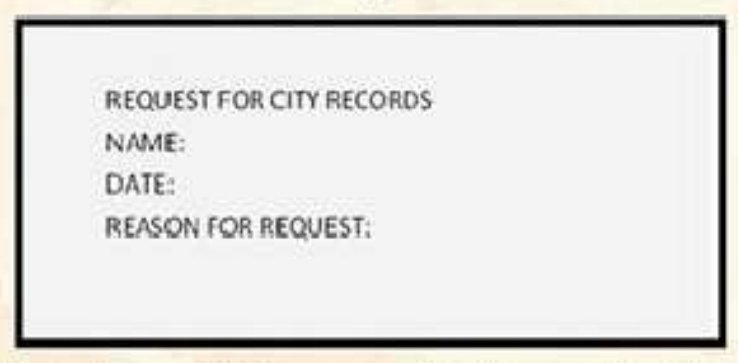

округ забрал чью-то собственность, это тоже будет записано здесь. Ни один из этих документов по-настоящему не поможет расследованию, и в этом модуле они не приводятся.

Если сыщики будут искать реестр церквей и найдут его, выдайте им раздатку 5. Они заметят, что в реестре пропущен номер: его изменили, чтобы убрать из реестра часовню Пиджен-Коув. Если сыщики будут искать судебные документы по делу Альберта Джоя об убийстве 1877 года, они узнают, что его арестовали, судили за убийство и признали виновным. Его приговорили к смерти, но позже заменили казнь пожизненным заключением. Это было 44 года назад; если сыщики захотят поговорить с мистером Джоем, выяснится, что он умер в тюрьме несколько лет назад.

<u>Нэш Филбертон</u>. Нэшу 41 год, он всегда очень корректен. Рост — 180 см, кожа светло-смуглая, каштановые волосы до времени поседели и поредели. Ещё Нэш глухой. Он объясняется на языке жестов. Он умеет читать по губам, но если сыщики попросят какие-нибудь документы, он даст им вот такой бланк.

**Выдайте сыщикам раздатку 6**



> **Раздатка 6**
>
> Запрос на городские документы
>
> Имя:
>
> Дата:
>
> Причина запроса:

Когда сыщики заполнят бланк, Нэш направит их к одной из дверей в боковых стенах. Его картотека так запутана, что любая проверка Работы в библиотеке здесь идёт со штрафной костью. Если сыщики продолжат расспрашивать о часовне Пиджен-Коув, он заявит, что помогать им не будет, а сам незаметно передаст им записку с просьбой прийти к нему домой на Скул-стрит, 224 (место 34), сегодня в 19:30.

*Прим. перев.: здесь в оригинале служащий один раз назван «Nathan» вместо «Nash».*

```stat
Нэш Филбертон
СИЛ 50  ВЫН 60  ТЕЛ 55  ИНТ 70  МОЩ 60  ЛВК 50  НАР 50
Рассудок 60  ОБР 80  Удача 55  ПЗ 11  Скорость: 7  Комплекция: 0
Бонус к урону: нет
Навыки: Ближний бой (драка) 25%, урон 1d3+БкУ;
Работа в библиотеке 80%; Скрытность 60%;
Внимание 65%
```

# Место 20
## Церковь универсалистов

Универсалисты служили в конгрегационалистской церкви, пока их не выгнали оттуда в 1839 году, когда строились туннели. С тех пор они построили себе собственное здание на Кливз-стрит. Это обычная христианская церковь со скамьями и кафедрой; повсюду образа Иисуса и Девы Марии — и на картинах, и в скульптурах. По воскресеньям утром и по средам вечером проходят службы; на них бывает около трёх десятков прихожан, в том числе Сара и Кристина.

<u>Бернард Леонг</u>. Церковью универсалистов руководит этот 58-летний священник. Он тучный, седой, кожа у него в белых и красных пятнах от недавнего солнечного ожога. Он щедрый и добрый, но часто зевает. В культе он не состоит, но знает о культистах и твёрдо намерен их остановить. Он видел, как они входили в конгрегационалистскую церковь, и потому считает, что преподобный Линн — один из них. Кристофер знает, что в воскресенье, 7 августа, что-то случилось. Он почувствовал силу. Он очень чувствителен к магии и к заклинаниям, которые творят в городе. Ещё он видел, как в бухту упала звезда, и наблюдал, как несколько человек вышли в море на лодках и вытащили что-то
