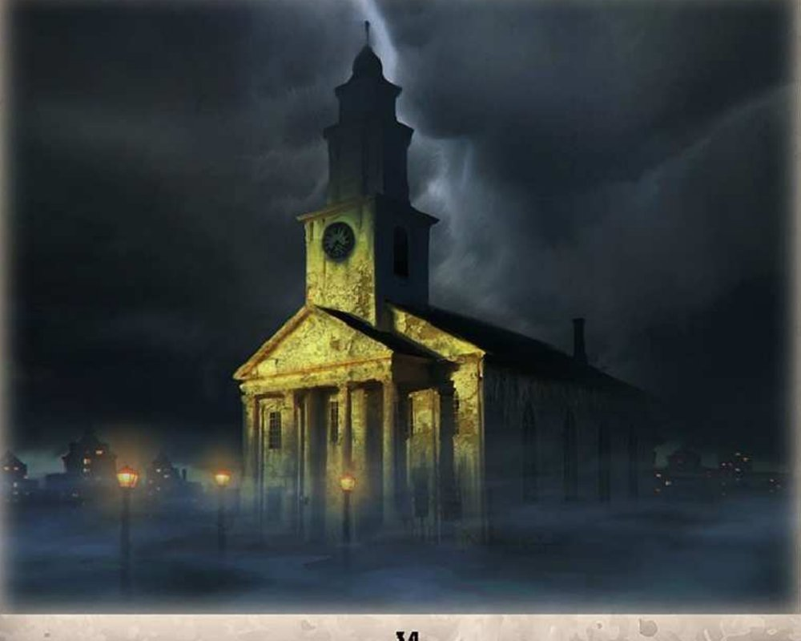

обратно в бухту, но близко не подходил и не разглядел, что это было. С тех пор художники стали пропадать не по одному в неделю, а по одному в день. Он знает о глубоководных, хотя называет их водяными демонами.

Если сыщики заговорят с ним, он сильно испугается. Он подозревает, что они из культа и проверяют его. Если сыщики завоюют его доверие несколькими успешными проверками Убеждения, он расскажет им о падающей звезде. Ещё он скажет, что Саре из Дома Вудса и Кристине из скобяной лавки можно доверять. Он знает, что Кристина (место 3) строит ловушку, но знает и то, что ловушка далеко не достаточно велика. Он знает о часовне Пиджен-Коув и считает, что Джек Сардоникус — один из вождей культа. Если сыщикам понадобится убежище, он предложит им укрыться в своей церкви.

*Прим. перев.: в оригинале священник один раз назван «Christopher» вместо «Bernard».*

# Место 21
## Конгрегационалистская церковь
## Церковь Олд-Слуп

Эту церковь основали в 1800 году. За эти годы в ней собирались последователи разных вер, в том числе культ Ктулху, который когда-то и построил часовню у карьера. В подвале церкви есть вход в туннель, ведущий в камеру T2.

