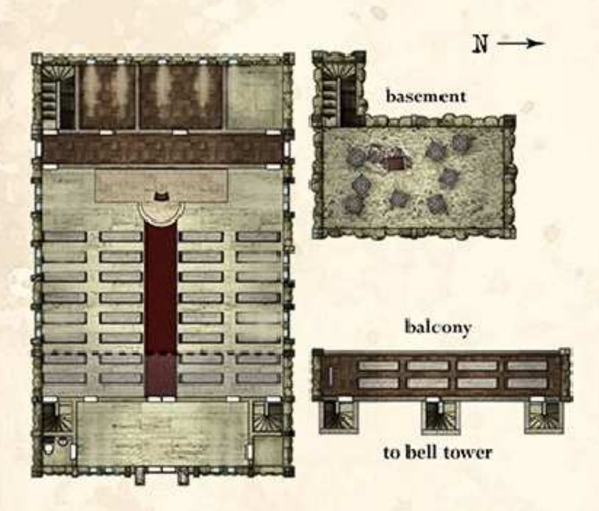

Церковь стоит на Скул-стрит, чуть в стороне от Мейн-стрит. Главный зал — большое помещение со сводчатым потолком. В боковых стенах молельного зала — витражные окна высотой в два этажа. Деревянные скамьи стоят в четыре ряда, по шесть скамей в каждом. Переднюю часть зала занимает большая кафедра на возвышении. На стене за кафедрой висит большой крест. Пол из твёрдого дерева красиво отделан, а по центральному проходу и вверх по четырём ступеням к кафедре тянется красная ковровая дорожка. Сбоку стоит небольшой орган.

*На плане: N → — север; basement — подвал; balcony — балкон; to bell tower — к колокольне.*

Три большие двери в южной стене ведут в небольшой притвор, отделяющий главный зал от улицы. Из притвора на улицу ведут ещё три двери. По обоим концам притвора лестницы поднимаются на балкон, откуда виден главный зал. В глубине балкона — маленькая запертая дверь. За ней ещё одна лестница — наверх, к часам и колокольне. Ключ — у преподобного Линна.

В глубине главного зала — две маленькие двери. Обе ведут в коридор, который тянется во всю ширину церкви. В западной стене коридора четыре двери, в северной и южной — по одной. Двери на концах коридора ведут на улицу. Южную дверь преподобный Линн оставляет незапертой для культистов. Первая дверь в западной стене ведёт на лестницу в подвал.

За второй дверью — маленький кабинет с письменным столом, стулом и несколькими картотечными шкафами. За третьей дверью — маленькая спальня с кроватью, платяным шкафом и сундуком. В них личные вещи преподобного Линна: одежда, Библия, крест, перчатки и пара туфель. Последняя дверь — кладовая, где хранятся реквизит, церковная утварь и украшения, которыми церковь пользуется на разные праздники.

В 1814 году британский фрегат HMS «Нимфа» выстрелил по церковному колоколу, но попал в шпиль. Ядро застряло в шпиле, и его было видно до 1840 года, когда церковь перестроили, а шпиль расширили под больший колокол. Сначала ядро собирались вынуть, но, взявшись за дело, поняли, что ядро зачаровано, чтобы пробить дыру в другое измерение. Оно так и не взорвалось, а вместо этого запечатывает маленький разрыв в Бездну. Ядро не стали вынимать, а обстроили вокруг него.

<u>Преподобный Рональд Линн</u>. У этого 60-летнего проповедника короткие чёрные курчавые волосы, начинающие седеть, и голубые глаза. Он знает о культистах и о входе в туннель. Он заключил с ними сделку: оставляет боковую дверь незапертой, чтобы культисты могли пользоваться входом, а они взамен согласились
