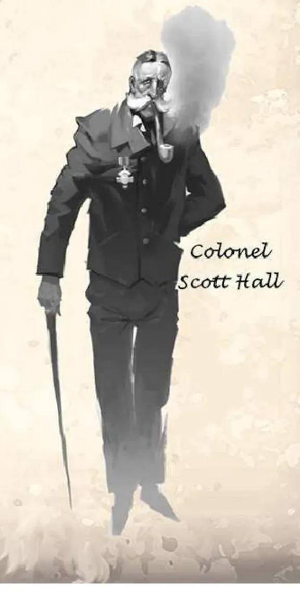

не скармливать его глубоководным. Он смертельно боится культистов и ничего о них не скажет. Держится он смиренно и вежливо.

Преподобный Линн поможет сыщикам только в одном случае — если они уберут ядро. Оно больше ста лет запечатывает дыру, и Линн боится, что оно взорвётся и откроет разлом в другой мир. Если сыщики справятся с побочным заданием *«Ключ к Бездне»*, преподобный Линн им поможет и расскажет всё, что знает о культе и о входе в систему туннелей из подвала. Побочное задание — в конце книги.

# Место 22
## Магазин Джона Тарра

Магазин Джона Тарра, основанный в 1887 году, торгует одеждой и обувью на любой случай, в том числе особыми предметами одежды, какие могут кому-нибудь понадобиться. Если сыщикам в Рокпорте понадобится какая-нибудь одежда, обувь и тому подобное, всё можно купить здесь, а особые вещи за хорошую цену достанут быстро (за 1–2 дня).

<u>Сэмюэл Кокс</u>. Сэм — или Сэмми, как зовут его близкие друзья, — ростом 175 см, чернокожий, с чёрными волосами и карими глазами. Для своих 25 лет он полноват; он всегда полон надежд, приветлив и очень известен в городе. Он лучший портной в Рокпорте, и за его костюмами и одеждой приезжают со всего округа. О культе он ничего не знает. Он видел в бухте кое-что странное, но плавать не умеет и потому в море не выходит.

# Место 23
## Мемориальный зал Рокпорта

Это здание из красного кирпича служит местом, где ветераны отдыхают, устраивают встречи и просто отвлекаются от повседневной жизни после ужасов войны. Зал — большое помещение с дверью в глубине, ведущей в жилые комнаты. В небольшом баре в дальнем левом углу нет спиртного, зато есть несколько сортов чая и кофе, сигареты и сигары. По залу расставлены удобные кресла и диваны. На стенах — картины с военными в мундирах и батальные сцены. Залом заведует полковник Скотт Холл, герой Великой войны. Он живёт в задних комнатах и следит, чтобы здесь было чисто и всего хватало для ветеранов, которые приходят отдохнуть. Успешная проверка Внимания позволит заметить, что на одной из батальных картин полковник Холл ведёт солдат в атаку. Есть подвал,

