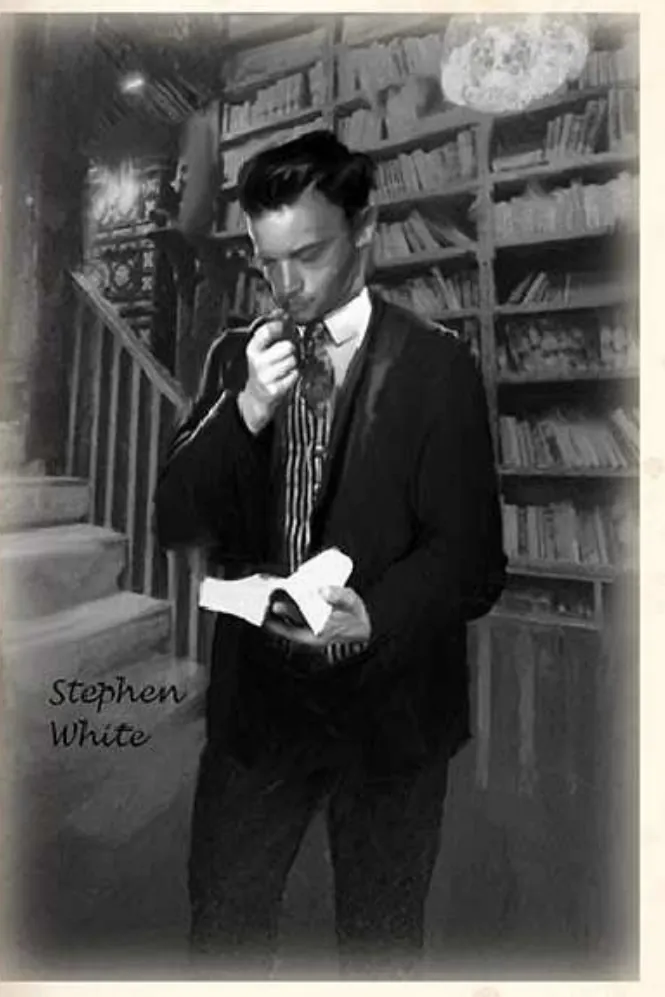

<u>Стивен Уайт</u>. Стивену 37 лет, но держится он так, будто ему двадцать с небольшим, и одевается ярко. У него рыже-огненные волосы, рост — 180 см. Он очень мрачен и всегда говорит о себе в третьем лице. Но если сыщики ему подыграют, он расскажет им о каждой из раздаток, кроме 13-й. Её он тоже может найти, но на это у него уйдёт время до следующего дня.

# Место 25
## Кафе «Сэнди-Бэй»

В этом кафе подают лучшие завтраки, обеды и лёгкие ужины, каких только может пожелать сыщик, проникающий в бездонное непостижимое. Как и большинство здешних заведений, это маленькое здание. Спереди — зал с пятью столиками и большой стойкой, за которой отпускают еду; там всегда есть свежезаваренный чай и кофе. За стойкой — кухня, где Рон готовит.

В глубине кухни небольшая лестница ведёт наверх, в маленькую квартирку Эвелин и Рона. В ней гостиная, спальня и маленькая ванная. Ничего ценного там нет. Вторая маленькая дверь ведёт в подвал, где хранятся запасы продуктов и есть прохладная комната для скоропортящегося. На самой кухне — обычный набор кухонной утвари: кастрюли, сковородки, разделочные доски и прочее.

<u>Эвелин Макгилликатти-Джонс</u>. Эта пухленькая 52-летняя женщина с розоватой кожей и серебристыми волосами всегда оживлена и любому рада в своём кафе. Она напомнит кого угодно типичную соседку-сплетницу. Она очень любопытна и, если чужаки отвечают, засыплет их вопросами. У неё на всё твёрдое мнение, она терпеть не может спиртного, зато обожает курить и часто дымит в глубине кафе. Она знает о культе, видела, как его люди по ночам входят в Олд-Слуп, но рассуждает так: каждому своё. Дай ей волю — заговорит любого посетителя до полусмерти. Её можно увидеть, когда она после закрытия несёт остатки еды художникам.

Если её расспросить, она скажет, что здесь никогда не происходит ничего интересного. Упомянет нынешнюю затею с художниками. Расскажет, что художники начали приезжать несколько месяцев назад: живут несколько недель, а потом просто уезжают среди ночи. Ей не нравятся их самые мрачные, самые извращённые картины, и она заявляет, что эти люди — сборище язычников. Но ей их жаль. Она дважды вдова, а за Рона так и не вышла, хотя всем они говорят, что женаты. Она считает, что
