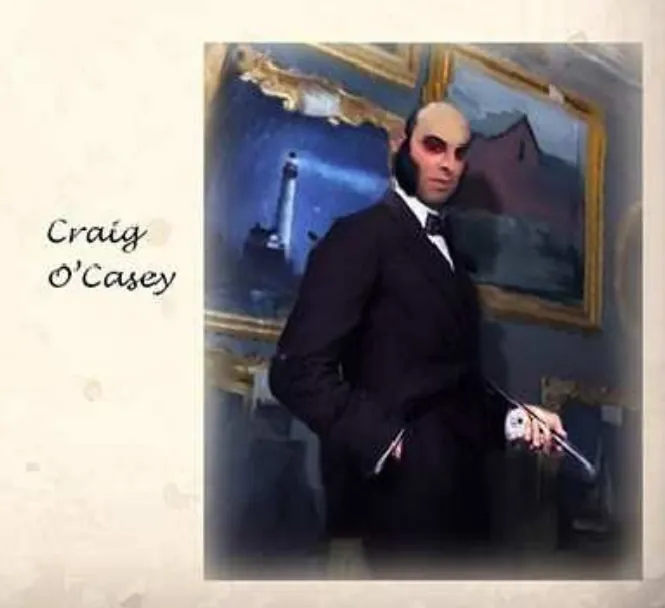

над ней лежит проклятие, и боится, что Рона, если они поженятся, постигнет та же участь, что двух её прежних мужей.

<u>Рон Линн</u>. У этого 57-летнего мужчины чуть смуглая кожа и седые волосы. Он заведует кухней, а все разговоры оставляет жене. Он грубоват и почти ни с кем не говорит иначе как односложно — разве что жене что-нибудь угрожает. На всякий случай он держит в задней комнате дробовик, хотя не пускал его в ход уже много лет. Если кто-нибудь будет угрожать его жене, он выйдет с дробовиком и потребует, чтобы обидчики ушли. Если угрожать ему самому, он выстрелит, но не станет рисковать попасть в жену.

# Место 26
## Художественная ассоциация Рокпорта

Художественная ассоциация Рокпорта открылась совсем недавно. Её владелец — Крейг О’Кейси; он состоит в культе, но почти ничего не знает ни о самой организации, ни о её делах. Его задача — следить, чтобы художники на Бэрскин-Нек были сыты и обеспечены красками и холстами. Лучшие картины, в том числе свои, он вывешивает в галерее, чтобы собрать деньги на содержание художников.

Передние три четверти помещения увешаны картинами с Красным сараем, парусниками, маяками и тому подобным. В дальнем углу — картины куда мрачнее: чудовища, боль и смерть. Каждый, кто на них смотрит, проходит проверку Рассудка (0/1). Все картины написаны Крейгом О’Кейси, художниками с Бэрскин-Нек или людьми, которые пропали. Кроме того, при успешной проверке Внимания сыщики заметят на каждой картине один и тот же узор. На ночных картинах узор обычно в звёздах, и разглядеть его довольно легко, но, кто однажды его увидел, тому уже трудно его не замечать. Проверка Астрономии подтвердит, что это НЕ известное созвездие.

**Выдайте сыщикам раздатку 14**

На самом деле это созвездие, в котором находится Земля, если смотреть с планеты, откуда пришло звёздное отродье. Ещё это расположение входов в туннели вокруг Рокпорта: его можно заметить успешной проверкой Внимания с вершины одного из маяков, если сыщики уже видели этот узор на картинах. На крыше каждого здания, где есть вход, стоит особый каменный знак. Это же — то последнее расположение светил, которое нужно для исполнения замысла Габриэля.

<u>Крейг О’Кейси</u>. У этого довольно странного на вид 44-летнего человека чёрные волосы и лысина. Он очень вспыльчив и любит спорить. Одежда ему мала и обычно забрызгана краской. Ему снятся мучительные сны о планетах, странных существах и смерти — и всё это отражается в его картинах. Если дойдёт до дела, он струсит, но о туннелях и подземной часовне он ничего не знает. Спит он в маленькой спальне позади Художественной ассоциации. Там же можно найти картины, в том числе те, что на передней и задней обложках этой книги.

