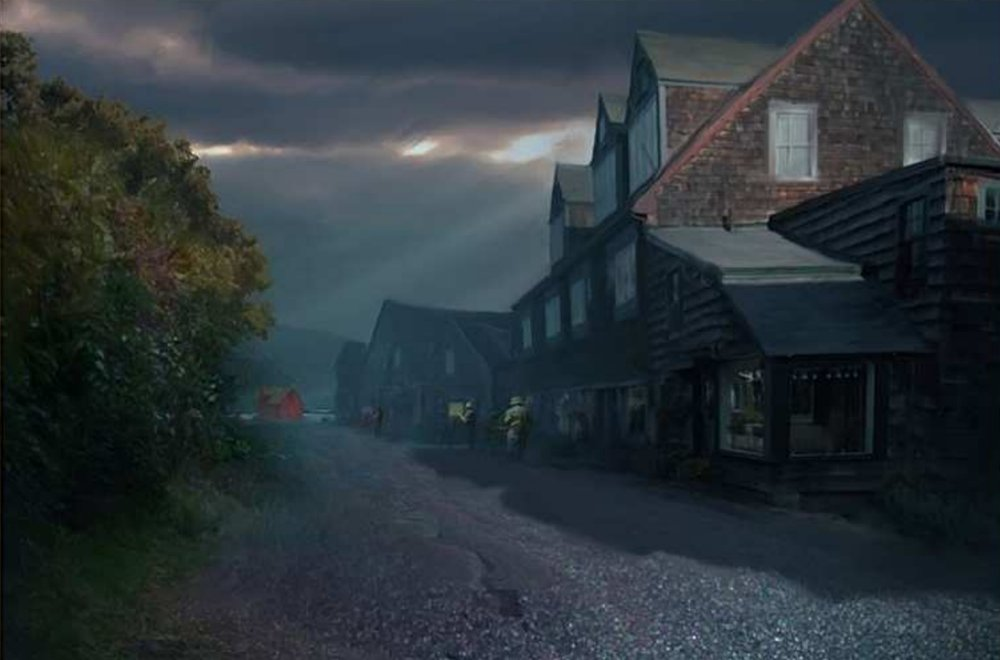

# Место 27
## Бэрскин-Нек

Это небольшая полоска земли между Док-сквер и пристанью Брэдли. Сюда приезжают писать художники со всего восточного побережья. Одни пишут Красный сарай, другие — маяки, третьи — просто лодки и море. Осмотрев картины, можно понять, что художники хоть и не совсем бездарны, но и не профессионалы. Если сыщик пройдёт проверку Искусства или Живописи, он поймёт, что эти люди толком не умеют работать с тенями, светом и фактурой. Любой разговор с художниками похож на беседу с человеком, которому разговор совсем не интересен и который отвечает только из вежливости. Если спросить, зачем они здесь, ответ будет примерно такой: «Я всегда хотел приехать сюда и писать» или «На меня нашло такое желание».

<u>Говард Смит</u>. Сейчас лучший художник на пристани. Этот 23-летний мужчина с русыми волосами бросил молочную ферму в Пенсильвании, чтобы приехать сюда писать.

<u>Стефани Томпсон</u>. Стефани 36 лет, у неё чёрные волосы и четверо детей дома, в Мэриленде. Она приехала только вчера и едва начала свою первую картину.

<u>Эндрю Грин</u>. Эндрю здесь дольше всех. Этот 45-летний мужчина лыс; рядом с ним на земле стоят несколько картин. Его картины становятся всё мрачнее, потому что каждую ночь ему снятся всё более мрачные сны. После первого визита сыщиков к художникам Эндрю ночью похитят и посадят в клетку в подземном храме.

