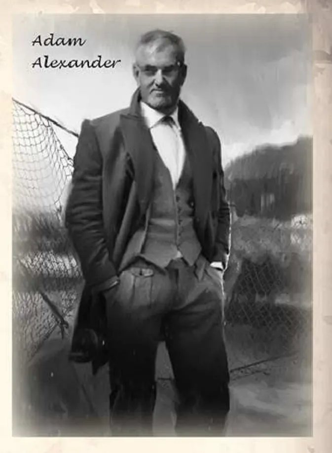

# Место 28
## «Суда и рыбалка братьев Брэдли»

Пристань Брэдли принадлежит Адаму Александеру. «Суда и рыбалка братьев Брэдли» — довольно маленькая лавка, где Адам даёт напрокат лодки и продаёт рыболовные снасти. Стойка делит здание пополам. Стены украшены штурвалами, сетями и рыболовными снастями.

С одного края стойки — откидная доска: подняв её, можно пройти из передней части за стойку. В другом конце здания, за стойкой, люк ведёт вниз, в туннели, в камеру T3.

Пристань Брэдли построили в 1842 году Джон и Джим Брэдли. «Рыбалка и перевозки братьев Брэдли» и её рыбацкий сарай были выстроены прямо на пристани. Позже, в 1870-х годах, пристань удлинили, и братья продавали участки на ней. В 1884 году пристань, дело и сарай перешли от братьев к сыну Джона, Джону-младшему. В 1912 году он передал их своему сыну, Джиму Брэдли. В 1915 году Джим проиграл пристань, дело и рыбацкий сарай Адаму в карты. Вскоре после этого Джим Брэдли уехал из города.

Сыщики могут взять лодку напрокат за 1 доллар в день, а за ещё 1 доллар — нанять лоцмана.

<u>Адам Александер</u>. Адаму 53 года, рост у него самый обычный — 175 см; короткие седые волосы всегда растрёпаны, у него борода и усы. Он носит стальной браслет. Он вырос в Рокпорте и никогда ни в чём не преуспевал. Он любит рыбалку, ходить под парусом и возиться с лодками, но в итоге работал в карьерах — до того счастливого дня 6 лет назад, когда выиграл пристань в карты.

С тех пор он превратил её в успешное и честное дело. Иметь дело с культом ему не очень-то хочется, но он состоит в нём с тех пор, как работал в карьере, и это культ подстроил так, чтобы он выиграл пристань в карты. Он знает о культе и туннелях, но в культе он мелкая сошка.

Ему надоели художники, которые околачиваются на Бэрскин-Нек. Он знает, что культ зачаровал Красный сарай, в котором Адам живёт. Он не против, чтобы они его писали, но они подбираются всё ближе и ближе, и держать их подальше от лавки и дома — постоянная борьба. Он всегда очень осторожен в словах и, если видит ссору, всегда старается всех примирить. В остальном ему, как правило, безразлично, что
