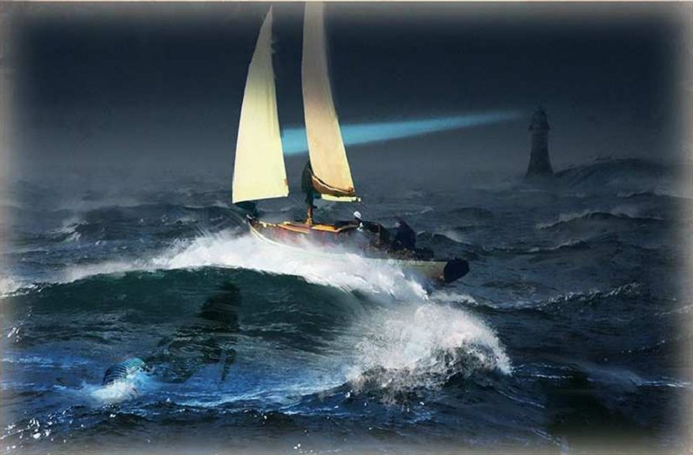

говорят или делают окружающие.

Если он увидит, что сыщики слоняются у пристани или у его дома, он рассердится и велит им держаться подальше, вместе с остальными художниками. Убедившись, что они не из бездумных художников, он спросит, чем может им помочь. Он охотно расскажет о пристани или о своём доме. Он видел бронзовую табличку сбоку пристани, но так и не удосужился её прочесть: она там всегда была. В свой дом он их не пустит.

<u>Эдди Гай</u>. Эдди всего 25 лет, но он очень невозмутимый и опытный моряк. Ходить под парусом — его любовь и его жизнь. Светлые волосы он собирает в хвост, носит шорты и свободную рубашку, застёгнутую только до половины. О культе он ничего не знает, но повидал в море много странного. С глубоководными он не сталкивался — разве что мельком видел их в океане.

Если сыщики наймут капитана лодки, чтобы сплавать к маякам и по бухте, им достанется Эдди. Он всегда очень вежлив и любезничает с дамами. Если сыщики впервые плывут на остров, он предупредит их о надвигающемся шторме. На обратном пути от маяков разразится шторм. Сильный ветер и волнение не дадут моряку ни минуты покоя: ему придётся управляться со своей двухмачтовой лодкой. В какой-то момент он прокричит в ветер: «Сегодня тебе меня не поймать, старая ведьма!» Если спросить его об этом, он расскажет свою историю:
