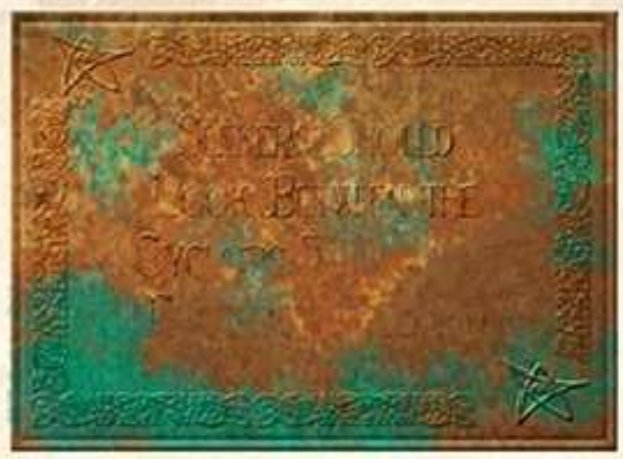
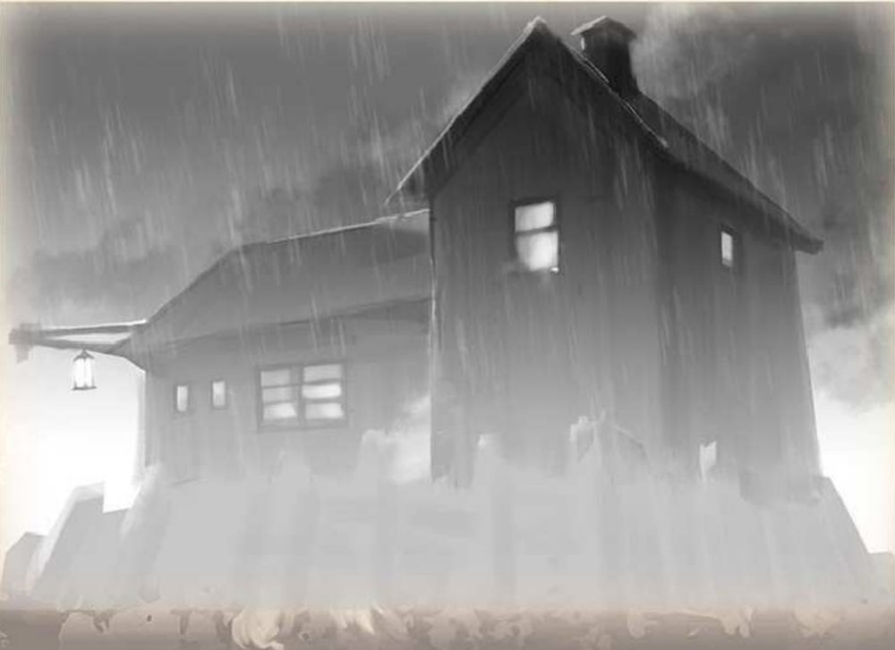

*«Говорят, старуха, что живёт в Доме ведьмы в Пиджен-Коув, насылала эти небывалые штормы, чтобы губить моряков. Будто бы какие-то твари, что живут в городе под водой, ловили их, когда те падали в воду с перевернувшихся лодок. А потом твари утаскивали их в глубину и приносили в жертву своим тёмным богам».* Он смотрит, какое это произвело впечатление. *«Будто ведьма была заодно с этими подводными тварями. Да только всё это бабьи сказки».*

# Место 29
## Красный сарай («Мотив № 1»)

Красный сарай стоит на самом конце пристани Брэдли. Ему больше ста лет, и за эти годы он служил разным целям, а сейчас в нём живёт Адам Александер. В здании пара дверей, но все они заперты, и несколько окон. Внутри нет ничего необычного — обычные домашние вещи да снаряжение для рыбалки и лодок. Если сыщики заглянут в окно, они увидят обычный маленький неприбранный дом.

> **Раздатка 15**
>
> Ищущим следует искать между Цикл…

На северо-восточной стороне каменного причала — бронзовая металлическая табличка. В прилив табличку заливает, а в отлив видна большая её часть. В любое время проверка Слуха позволит расслышать лёгкий металлический стук в такт волнам.

