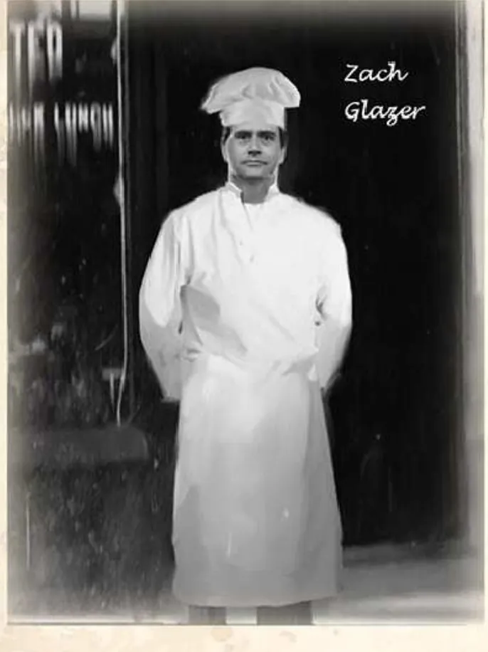

# Место 31
## Пекарня «Сэнди-Бэй»

Эта пекарня печёт самый разный хлеб, булочки, сдобу, торты и кексы. Она славится своими пончиками. Но Зак пошёл дальше обычного круглого пончика с дыркой посередине: он покрывает пончик сладкой глазурью — очевидно, в честь собственной фамилии (по-английски «глазурь» — *glaze*). Спереди в пекарне маленькая лавка с большой стеклянной витриной, где выставлена выпечка дня. За прилавком — кухня, где Зак всё и печёт. Наверху — жилые комнаты Зака.

<u>Зак Глейзер</u>. При росте 173 см и худом сложении 32-летний Зак выглядит не очень внушительно. У него бронзовая кожа и светлые волосы; он был бы очень хорош собой, если бы не тонкий слой муки на лице. Он обожает печь и почти всегда ходит в белой блузе и поварском колпаке. Его часто можно увидеть, когда он раздаёт выпечку художникам на Бэрскин-Нек. Он щедр, но кормить художников ему платит культ. Он считается членом культа, но ни на одном собрании не был. Он знает, что собираются в часовне Пиджен-Коув. Завербовал его преподобный Сардоникус. О туннелях и подземной часовне он не знает.

Ричард — большой пессимист: в любых огрехах своей выпечки он винит туман, который висит над городом. Ещё он думает, что культ скоро устроит конец света.

*Прим. перев.: здесь в оригинале пекарь один раз назван «Richard» вместо «Zach».*

# Место 32
## Театр Рокпорта

Этот маленький театр открыли в 1919 году Кевин и Деандра Райт. В нём шли несколько пьес со Второй авеню и номера с площадок вне Бродвея, в том числе водевильные. Все их постановки, как правило, вышли несколько лет назад. Сейчас идёт оперетта «Светлячок» Рудольфа Фримля. Это история уличной певицы из Нью-Йорка, которая отправляется на Бермуды и становится великой оперной дивой.

Маленький театр вмещает около 130 зрителей: 80 в партере, 30 на балконе и ещё 20 в четырёх ложах.

<u>Кевин Райт</u>. Кевин ростом 178 см мнит себя великим режиссёром, но никак не может найти приличных актёров себе в труппу вокруг жены. Его жена Деандра играет главную женскую роль в каждой пьесе. Почти каждый
