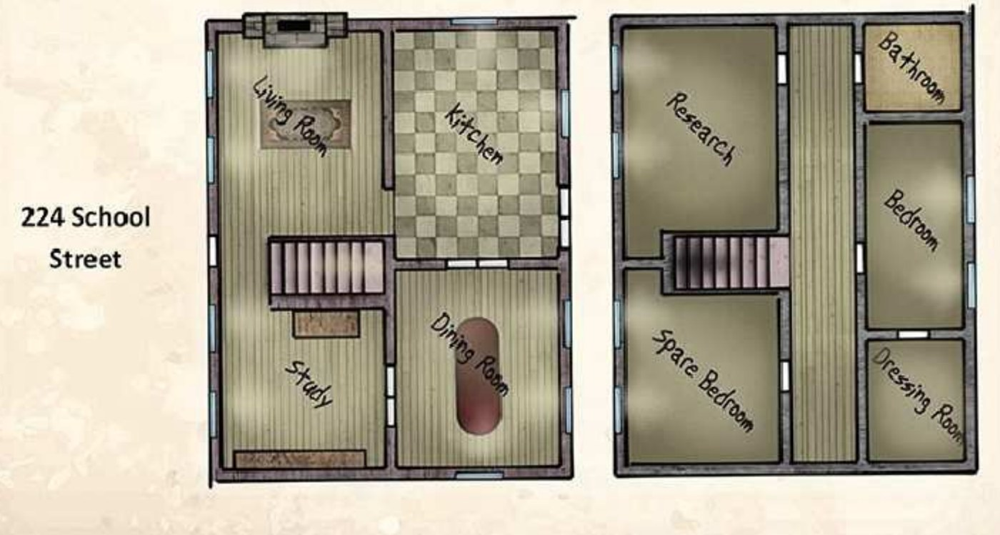

из дома. Если за ними погонятся, они побегут на запад, сквозь толпу, выходящую из Театра Рокпорта (место 32), а оттуда — в Олд-Слуп (место 21) и в туннели. Если одного из них тяжело ранят, второй, скорее всего, перережет ему горло, чтобы того не взяли живым.

Умирая, Нэш успеет нарисовать кровью стрелку, указывающую на один из кухонных шкафов. Под шкафом — маленький тайник, где он хранит список известных ему культистов:

Джастис Гордан, Адам Александер, Крейг О’Кейси, Мишель Фуази, Ребекка Вуд, Джек Сардоникус, Рэйвен Алексис и Габриэль Ран.

Если Нэш выживет, он отдаст сыщикам всё, что у него есть о культе. Если он умрёт, у сыщиков будет немного времени, чтобы обыскать его кабинет для исследований наверху, пока не приехала полиция. Если сыщики будут в доме, когда приедет полиция, их арестуют за убийство. Если их увидят убегающими с места преступления, их будет разыскивать полиция.

В кабинете для исследований беспорядок, но успешная трудная проверка Внимания найдёт такие заметки:

- Большинство рабочих карьеров сбежали из города.
- Туман пришёл одновременно с падением звезды 9 августа.
- Число утонувших и погибших от несчастных случаев намного превышает обычное для города.
- Полиция отмахивается от чудовищ в бухте; думаю, полиция с ними заодно.
- Документы о больших земляных работах и закупках материалов за последние несколько десятилетий, начиная с середины XIX века, говорят о тайном, хорошо оплаченном замысле — строить скрытые здания или туннели.
- Часовню Пиджен-Коув убрали из списка зарегистрированных церквей в ратуше.

*На плане: 224 School Street — Скул-стрит, 224; первый этаж: Living Room — гостиная, Kitchen — кухня, Study — кабинет, Dining Room — столовая; второй этаж: Research — кабинет для исследований, Spare Bedroom — гостевая спальня, Bathroom — ванная, Bedroom — спальня, Dressing Room — гардеробная.*
