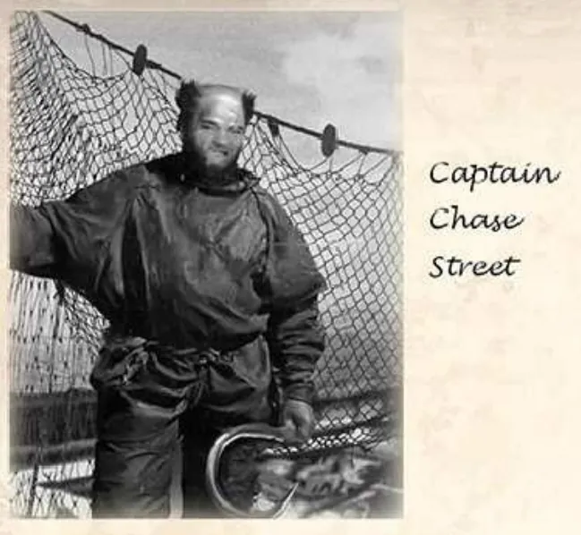

спросить, зачем у него гарпунные пушки и на носу, и на корме, он ответит: *«Одна — для когда ты гонишься, а другая — для когда гонятся за тобой»*. Капитан — просоленный морем человек, который никому не даёт спуску, но, если поднести ему несколько стаканчиков, он расскажет небывалые истории о морских чудовищах.

```stat
Капитан Чейз Стрит
СИЛ 70  ВЫН 70  ТЕЛ 60  ИНТ 50  МОЩ 60  ЛВК 50
НАР 40  Рассудок 15  ОБР 40  ПЗ 13  Скорость: 8  Комплекция: 1
Бонус к урону: +1d4     Уклонение 25%
Бой: Драка 60% (30/12), урон 1d3+БкУ
Нож 50% (25/10), урон 1d4+2+БкУ
Гарпунная пушка 50% (25/10), урон 2d10+2
Навыки: Ориентирование 70%; Выживание 40%; Внимание 60%;
Плавание 70%; Пилотирование (лодка) 90%; Искусство/ремесло (вязание узлов) 80%
```

```stat
Дэниел Кламиндер
СИЛ 65  ВЫН 70  ТЕЛ 55  ИНТ 70  МОЩ 50  ЛВК 70
НАР 60  Рассудок 50  ОБР 50  ПЗ 12  Скорость: 9  Комплекция: 0
Бонус к урону: нет     Уклонение 50%
Бой: Драка 40% (20/8), урон 1d3
Винтовка 45% (22/9), .30-06 со скользящим затвором — урон 2d6+4
Навыки: Метание 70% (35/14), гарпун; Плавание 70%;
Искусство/ремесло (узлы) 70%; Пилотирование (лодка) 40%; Ориентирование 40%
```

<u>Дэниел Кламиндер</u>. Дэниел — первый помощник. Рослый 24-летний парень с загорелой кожей и каштановыми волосами, на судне он как дома. Он служит у капитана Стрита уже 6 лет и ни за что его не предаст: капитан спасал ему жизнь по меньшей мере трижды. Дэниел тоже немало повидал из Мифов, хотя и далеко не столько, сколько капитан. Если кто-нибудь усомнится в здравом уме капитана, Дэниел заверит, что капитан в полном рассудке.

# Место 38
## Остров Стрейтсмут

Этот маленький остров лежит у самого берега Рокпорта; на его восточном берегу стоит маяк высотой 12 м. В маленьком домике на острове живёт смотритель маяка Рольф Халверсон. На острове, по правде, нет ничего особенного, но если сыщики поднимутся на смотровую площадку этого маяка, обычная проверка Внимания позволит разглядеть металлические плиты на зданиях Рокпорта, где есть входы в туннели.

<u>Рольф Халверсон</u>. Рольфу 53 года; он седой, полноватый, с бледной кожей. Он одиночка, любит море и ухватился за возможность прожить последние годы в одиночестве на острове.

# Место 39
## Редакция «Рокпорт рипорт»

«Рокпорт рипорт» — маленькая газета на одну страницу; выходит каждую неделю — смотря по тому, много ли в городе событий. Утром в день выхода номер доставляют в Дом Вудса (место 5), в библиотеку (место 24) и в аптеку (место 11). В тот день, когда приезжают сыщики, главные новости номера — туман и объявления о пропавших.

<u>Шон Тейлор</u>. Этот 32-летний мужчина — городской газетчик. Печатное оборудование у него допотопное. Он прекрасно знает о культе, но говорить о нём отказывается и берёт и печатает любую историю, какую ему дадут напечатать в полиции.
