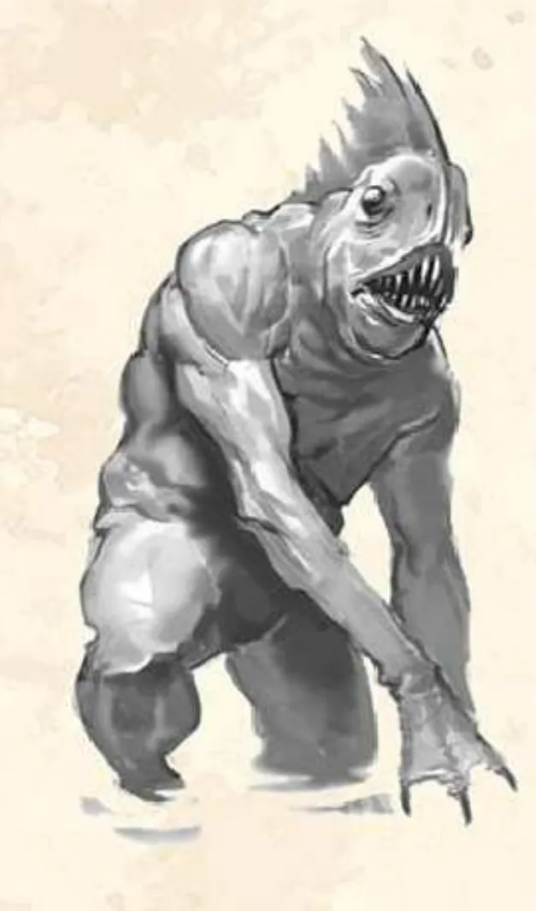

часовни заперт сверху. Чтобы сломать замок, нужна проверка противоборства против СИЛ 80.

<u>**Проход из T7 в T9**</u> — этот туннель забит старыми ящиками и коробками. Если сыщики идут тихо и прислушиваются, то при успешной проверке Слуха они услышат, как что-то движется среди ящиков и коробок. Иначе глубоководный с копьём застанет их врасплох. Из-за ящиков вступить с глубоководным в рукопашную или прицельно выстрелить в него может только один человек за раз.

<u>T9</u> — Подземная часовня. Это большое помещение — в основном естественная пещера, но местами её вырубили вручную. Высота — 9 м. Из помещения ведут два туннеля: один — в T7, примерно из середины южной стены, другой — в подводный туннель, из западной стены.

У восточной стены стоит статуя высотой 7,5 м, похожая на малую статую, которую ищут сыщики. У южной стены — пять запертых клеток. В клетках заперты три человека. Клетки — кубы со стороной 90 см; в них мужчина средних лет, женщина средних лет и девушка лет двадцати с небольшим (подробности ниже). По пещере разбросаны четыре бассейна, каждый около 3 м в поперечнике. В них живут трое глубоководных и звёздное отродье.

В центре пещеры — яма около 4,5 м в поперечнике. Над ямой поперёк лежит большой брус, обмотанный цепью, с воротом на одном конце. На конце цепи — пара окровавленных кандалов: на них жертв спускают в яму. Яма уходит вниз, в LT-1.

На северной стене в скале вырезаны большие буквы: «Ep’hai gof’nn kadishtu’agl ulnsll’ha Cthulhu na’fhtagn ep’yarnog».

В переводе это значит: «Когда дети выстроятся и воззовут к Нему, Ктулху пробудится, и придёт Его время».

Нападут трое глубоководных с копьями — двое из бассейнов и один из коридора. Если сыщики уже встретили глубоководного в проходе, здесь их будет только двое.

Гибрид глубоководного — преподобный Майкл Томас. Сбежав из тюрьмы, преподобный укрылся здесь и рассказал Габриэлю о статуе в своей часовне в Бостоне. С помощью глубоководных и Габриэля Майкла превратили в гибрида глубоководного. На теле глубоководного у него осталось человеческое лицо, так что если сыщики встречали преподобного Томаса в «Призраке», им, возможно, придётся
