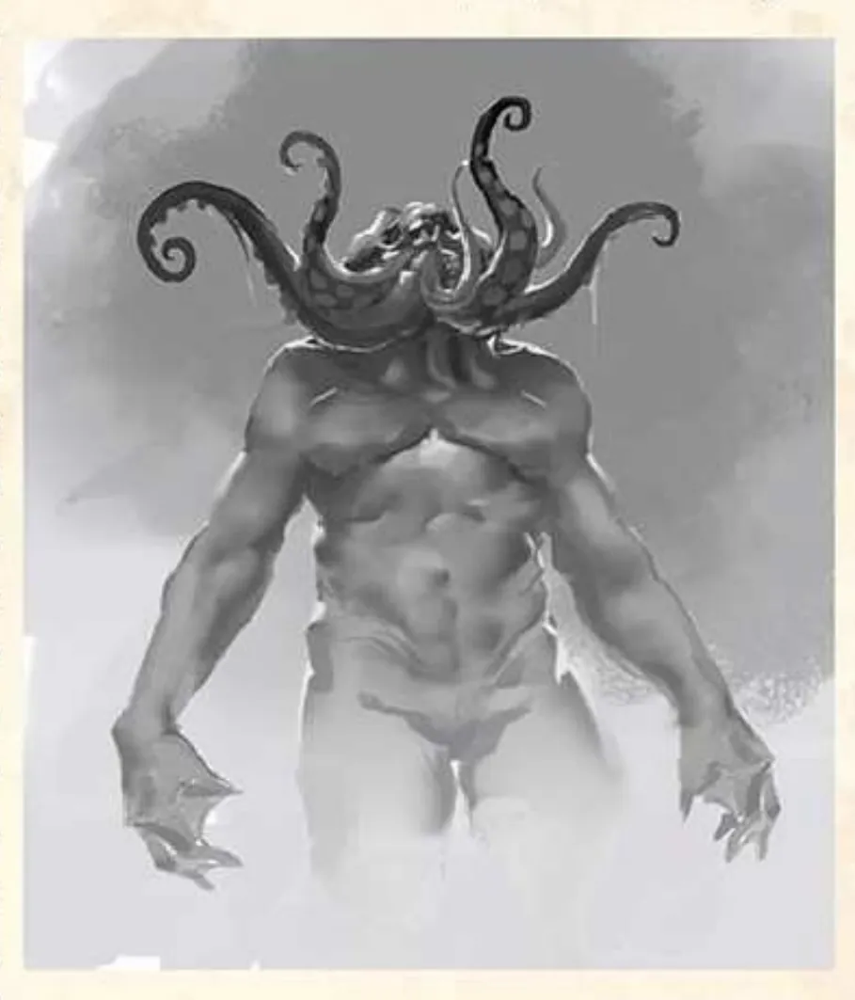

# Нижние туннели

Нижние туннели гораздо больше верхних: высота 6 м, ширина 4,5 м. Помещений всего четыре. По нижним туннелям плывёт жёлтый газ — смесь фтора с другими элементами. Он не смертелен, но долгое пребывание в нём приводит к болезням дыхания. Смесь не взрывоопасна. Газ нужен, чтобы воссоздать родную среду звёздного отродья.

Сыщики, которые дышат газом дольше 30 минут, получают штрафную кость на все проверки навыков; если пробыть в газе больше часа, сложность проверок навыков повышается на две ступени. Газ не взрывоопасен, но три бака, из которых поступает газовая смесь, можно уничтожить динамитом или другой взрывчаткой (например, сбросив её в яму сверху). Чтобы газ рассеялся настолько, что перестал быть опасен для сыщиков, нужно около 8 часов.

<u>LT-1</u>: это место прямо под ямой — центр системы нижних туннелей. Оно 9 м в поперечнике и 12 м в высоту. Отсюда ведут три прохода: в LT-2, LT-3 и LT-4. Туннель диаметром 4,5 м в потолке ведёт наверх, в T9. Здесь стоят три больших бака без маркировки. Из каждого бака сочится жёлтый газ и расходится по всем нижним туннелям.

Пол усеян останками жертв, принесённых за последнюю неделю. Они немного смягчают удар тому, кто случайно упадёт в яму, — такой сыщик может пройти проверку Удачи, чтобы не разбиться насмерть. Поняв, на что они упали или на что их спустили, сыщики должны пройти проверку Рассудка (0/1d3).

<u>LT-2</u>: туннель длиной 30 м ведёт из LT-1 вниз, в эту камеру примерно 9 м в поперечнике с большим бассейном. Вода тёплая: всего в 6 м под природным источником лежит пласт магмы. Вода очень прозрачна, и если сыщики посветят в неё фонарями, то увидят дно и несколько маленьких слепых белых рыбок, плавающих в бассейне. Здесь звёздное отродье купается и пьёт. Если сыщики спускаются в яму, с вероятностью 30% звёздное отродье окажется в этой камере.

<u>LT-3</u>: этот туннель длиной 24 м больше похож на тупик, чем на туннель. Его и правда не достроили. Звёздное отродье сваливает сюда отходы — в основном части человеческих тел, которые не может переварить. Когда сыщики подходят к этому помещению, их накрывает смрад.
