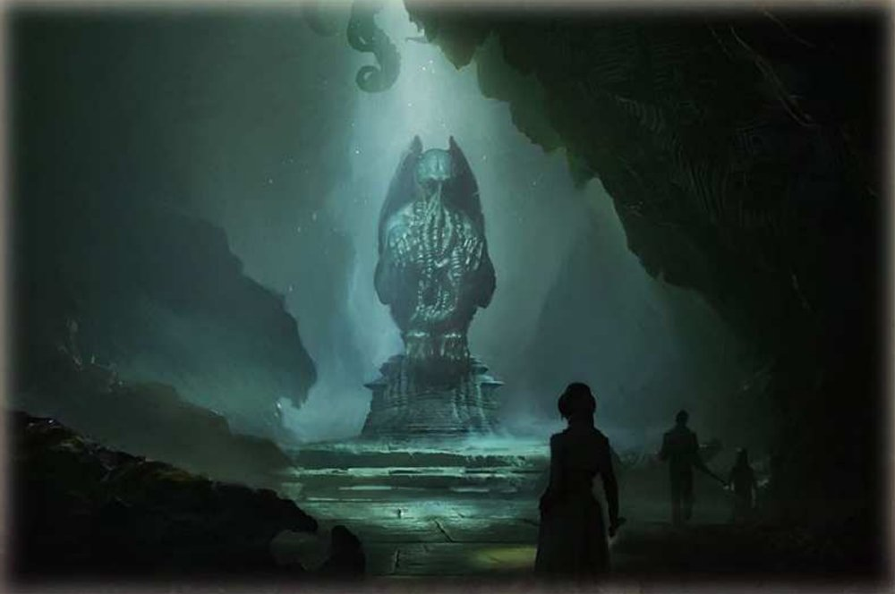

Все сыщики должны пройти проверку ВЫН, иначе им придётся отступить обратно в LT-1. Если обыскать кучу отбросов, сыщики найдут в ней останки семи скелетов. Если звёздное отродье уже вырывалось на свободу и буйствовало, останков будет ближе к двадцати. Если сыщики спускаются в нижние туннели, с вероятностью 20% звёздное отродье окажется в этом помещении.

*Прим. перев.: в оригинале «retreat back to T-1»; по смыслу — в LT-1.*

<u>LT-4</u>: этот туннель длиной 30 м ведёт в главное логово звёздного отродья. Это помещение неевклидовой формы почти 30 м от края до края, но из-за неправильных углов, ниш и закоулков измерить его почти невозможно. Наверх, на поверхность, просверлена дыра диаметром 90 см. Если в определённое время встать на центральный камень и посмотреть вверх по этому ходу, можно увидеть родную звезду звёздных отродий. Когда сыщики входят, звёздное отродье с вероятностью 50% окажется в этом помещении, в одной из ниш, и потому его не будет видно.

Посреди помещения на постаменте стоит статуя высотой 60 см. На неё падает свет с поверхности, и кажется, будто статуя высотой 6 м. Она мерцает, то исчезая, то появляясь. По мере того как сыщики подходят ближе, она съёживается до статуи высотой 60 см.

Из-за устройства помещения эхо мечется по нему и не стихает целыми днями. Даже если звёздного отродья здесь нет, при успешной проверке Слуха сыщики услышат шорох — шуршание плоти, скользящей по камню, — и слабый шёпот: «Помогите мне».

```stat
Звёздное отродье
СИЛ 240  ВЫН 130  ТЕЛ 400  ИНТ 90  МОЩ 90  ЛВК 40
ПЗ 78  Скорость: 12  Комплекция: 8  Бонус к урону: 7d6  Уклонение 26%
Атак за раунд: 4 — щупальцами на расстояние до 9 м или когтями в пределах 4,5 м. Урон = БкУ (7d6).
Если попадает когтем, значит, схватил цель.
Броня: 10 (шкура и ворвань)     Восстанавливает 3 ПЗ за раунд     Потеря Рассудка: 1d6/1d20
```

*Прим. перев.: так в оригинале — ПЗ 78 при (ВЫН 130 + ТЕЛ 400)/10 = 53; бонус к урону 7d6 и Комплекция 8 при СИЛ + ТЕЛ = 640 (по правилам +8d6 и 9); шанс атак не напечатан.*


