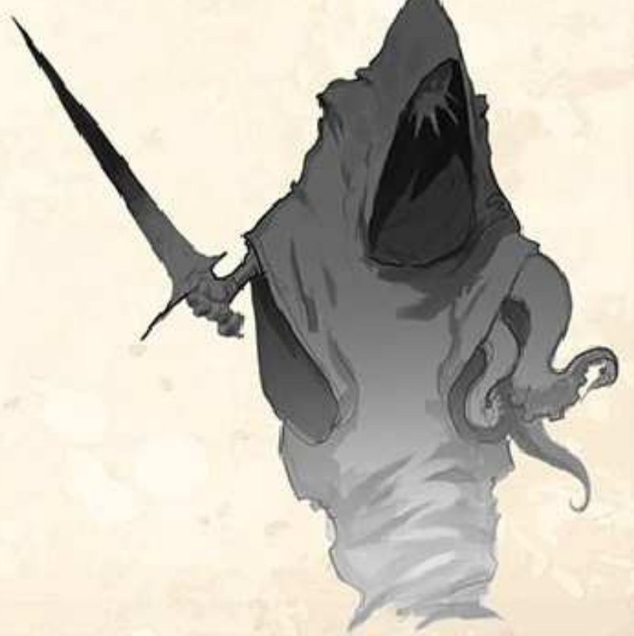

Следите за временем суток по ходу сценария. Церкви полны в воскресенье утром и в среду вечером. Некоторые заведения, например ратуша, по выходным закрыты. Одни события происходят сами собой с течением времени — например, каждую ночь сыщикам снятся сны. Другие случаются, только если сыщики совершат определённые действия или придут в определённые места. Когда происходят события, подробнее смотрите в перечне «События» в конце сценария.

# События

- Каждый день полковник Холл исследует новую часть туннелей, пока не пропадёт (место 23).
- Каждую ночь всем сыщикам снится один и тот же сон. Три ночи подряд — каждую ночь новый сон.
- В первый раз, когда сыщики отправятся на остров Тэтчер, пока они на острове, налетит шторм.
- В ночь после того, как сыщики поговорят с Эндрю Грином (место 27), он пропадёт. Если сыщики внимательны, они могут заметить, что каждую ночь пропадает один художник, а каждый день на Бэрскин-Нек приезжает писать новый.
- В ту ночь, когда сыщики должны встретиться с Нэшем Филбертоном (место 19) у него дома (место 34), на него нападут двое культистов.
- Если сыщики войдут в подземную часовню, на них нападут гибрид глубоководного (преподобный Томас) и двое глубоководных. Если они попадут туда, не пройдя по коридору из T7, глубоководных будет трое.
- Когда глубоководные будут убиты, Габриэль и Шэдоуз выследят сыщиков и нападут. Численность нападающих зависит от того, сколько сыщиков к этому времени ещё живы.
- Если Габриэль потерпит поражение — сбежит он или нет, — он освободит звёздное отродье от пут. Оно выберется из ямы, выйдет через карьер и двинется вверх по Бич-стрит, сея разрушение. 95% жителей бегут из города. Оставшиеся горожане дадут чудовищу последний бой. Если сыщики в городе, они могут присоединиться. В этой схватке погибнут начальник полиции и его помощники, а также почти все остальные. Звёздное отродье будет ранено достаточно, чтобы отступить в свою яму — восстанавливаться и лечиться. Из тех, кто мог бы помочь, в городе останутся только Кристина Смит (место 3), полковник Холл (место 23), Синди Альварес (место 16) и Алан Дуглас (место 17).

*Прим. перев.: Синди Альварес в сводке культистов (с. 62) значится среди культистов, а здесь — среди тех, кто может помочь; так в оригинале.*

