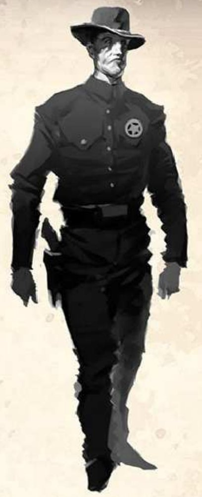

# Культисты



- Габриэль Ран* (место 14, с. 28)
    - Вождь культа
- Рэйвен «Шэдоуз» Алексис* (место 14, с. 28)
    - Любовница Габриэля
- Начальник полиции Кори Стаддард (место 1, с. 17)
    - Начальник полиции
- Полицейский Майкл Уайлд (место 1, с. 16)
    - Полицейский
- Преподобный Джек Сардоникус (место 14, с. 27)
    - Пастор часовни Пиджен-Коув
- Джастис Гордан* (место 7, с. 24)
    - Управляющий Гранитной компании Рокпорта
- Нил Маккарт** (место 9, с. 25)
    - Бригадир карьера № 2
- Пекка Мюллюлуома* (место 10, с. 25)
    - Бригадир карьера № 3
- Райан Гримсли** (места 7–9, с. 24)
    - Ночной сторож
- Мишель Фуази* (место 13, с. 27)
    - Парикмахер
- Синди Альварес (место 16, с. 27)
    - Ведьма из Дома ведьмы
- Марджори «Вулф» Остин* (место 18, с. 32)
    - Начальница почты
- Крейг О’Кейси (место 26, с. 39)
    - Торговец картинами, художник
- Адам Александер (место 28, с. 41)
    - Владелец «Братьев Брэдли» и Красного сарая
- Ребекка Вуд (место 4, с. 18)
    - Заведует железнодорожной станцией
- Зак Глейзер (место 31, с. 45)
    - Пекарь
- Кевин Райт* (место 32, с. 45)
    - Владелец Театра Рокпорта, актёр
- Деандра Райт (место 32, с. 46)
    - Владелица Театра Рокпорта, актриса
- Морин Догерти* (место 33, с. 46)
    - Владелица обивочной мастерской Така («Обивка и чистка»)

*Прим. перев.: в оригинале здесь «Majorie» вместо «Marjorie».*

\* — участвует в нападении культистов, описанном в «Событиях», если сыщики убьют глубоководных.

\*\* — этот персонаж Хранителя также один из двух культистов, которые нападают на Нэша Филбертона в месте 34, и участвует в главном нападении.

Этот статблок годится для любого культиста, у которого нет своего.

```stat
Культист Рокпорта (типовой)
СИЛ 55  ВЫН 55  ТЕЛ 66  ИНТ 65  МОЩ 55  ЛВК 55
НАР 55  Рассудок 35  ОБР 50  ПЗ 12  Скорость: 7  Комплекция: 0
Бонус к урону: нет
Бой: Драка 30% (15/6), урон 1d3
Меч 35% (17/7), урон 1d8+1
```
