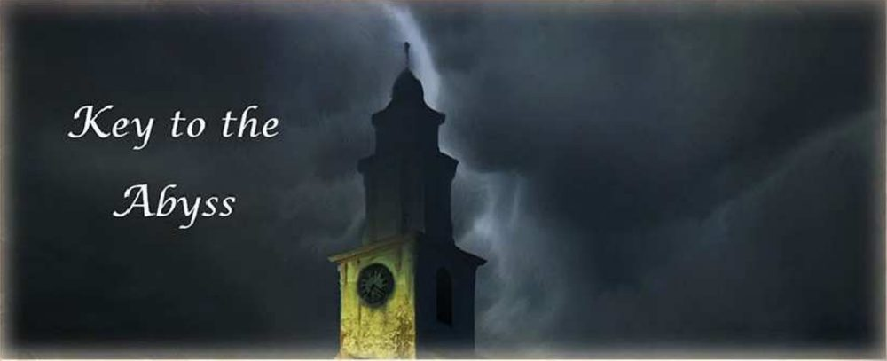

# Ключ к Бездне

## Введение

В 1814 году британский фрегат HMS *«Нимфа»* обстрелял церковь Олд-Слуп, пытаясь заставить замолчать её колокол. Куда менее известно, что ядро было напитано магией, которая должна была открыть зияющую дыру в Бездну. Выстрел прошёл мимо колокола и попал в шпиль, где ядро засело в постройке, не взорвавшись.

Магия была так сильна, что пушку сорвало с креплений, и она потопила *«Нимфу»*.

Хотя разрывной снаряд не сработал и не взорвался, руны, вырезанные на ядре, по-прежнему вполне действуют. Снаряд пролежал без движения больше ста лет, но в последнее время люди слышат, как из него доносится шипение.

Преподобный Линн знает, что нужно что-то делать, но не знает что. Несколько месяцев назад ядро пытались вынуть, но едва его сдвинули, открылась чёрная дыра. Руны на ядре вспыхнули, и прежде чем дыру успели снова заткнуть, *нечто* схватило рабочего и утащило его в дыру.

Священник даст сыщикам больше сведений о культе, если они решат его «проблему с ядром».

Этот модуль задуман как дополнение к основному модулю «Звезда на берегу»; места и люди, на которые он ссылается, описаны там.

Его можно вести и отдельно — тогда преподобный может заплатить сыщикам или оказать им услугу.

## Тайна Хранителя

Чтобы выполнить задание, сыщики должны осмотреть ядро и запомнить вырезанную на нём руну. На открытой поверхности ядра видна одна руна. В библиотеке с хорошим оккультным собранием — например, в библиотеке Мискатоникского университета или в конторе детективного агентства «Тёмное крыло» в Бостоне — сыщики найдут книгу, которая объяснит, что делать дальше.

Им нужна деревянная копия ядра со всеми рунами. Они не знают, что на ядре есть вторая, другая руна: её нужно будет добавить на копию, когда настоящее ядро вынут.
