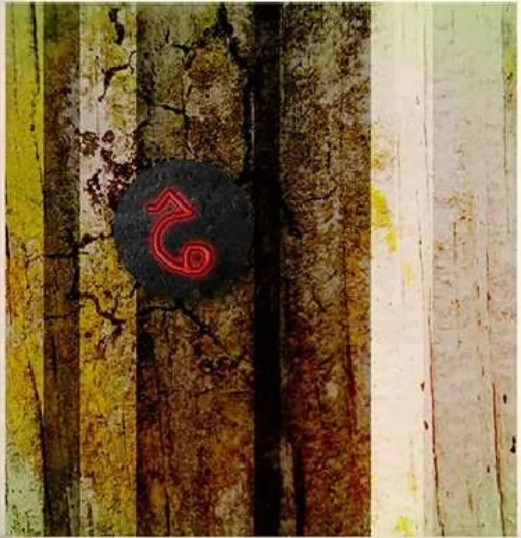

Сыщикам нужно будет также собрать ингредиенты для заклинания, в том числе синий очиток. Обычно он растёт только в Англии, но сыщикам повезло: синий очиток растёт у Дома ведьмы (место 16).

Сыщикам нужно построить временный помост, чтобы добраться до ядра и работать с ним.

Когда начнётся песнопение, ядро можно вынуть. Когда ядро вынуто, показывается вторая руна. Обе руны нужно вырезать на копии, чтобы как следует запечатать разлом. Тем временем ядро начнёт очень громко тикать, и любой, кто разбирается в боеприпасах, поймёт: до взрыва осталось всего несколько минут. Ядро нужно обезвредить, прежде чем вернуть его в дыру или куда-то перенести.

Разлом в Бездну неустойчив: без ядра он закрылся бы много лет назад. Если сыщики не запечатают врата копией, перед тем как разлом закроется, на волю вырвется по одной твари каждого вида из Бездны.

Пока всё это происходит, чтецы (не меньше двух) должны продолжать петь, чтобы дыра в Бездну оставалась запечатанной. Появятся морды тварей (и другие части тел, если сыщикам не везёт), и каждый, кто смотрит на отверстие (чтецы обязаны не сводить с него глаз), проходит проверки Рассудка. Чтец, сошедший с ума, перестаёт петь. Если чтецов становится меньше двух, печать слабеет, и твари будут лезть наружу, пока копию не доделают и не заткнут ею разлом.

## Ядро

Ядро засело в колокольне церкви Олд-Слуп. Проверка Внимания позволяет сыщикам разглядеть руну, вырезанную на ядре. Она почти стёрлась и почти невидима, пока кто-нибудь её не коснётся, — тогда она засветится красным. Если вынуть ядро сейчас, руна ярко вспыхнет и портал в Бездну откроется. Наружу хлестнёт щупальце (Рассудок 0/1d3), схватит ни в чём не повинного прохожего и утащит его, брыкающегося и кричащего, в дыру (Рассудок 1/1d6). Сыщики могут попытаться атаковать щупальце (броня 5). Если им удастся нанести ему 30 пунктов урона за один раунд, щупальце бросит прохожего и уберётся в дыру (и второй проверки Рассудка не будет). Если ядро после этого не вернуть на место, начинайте бросать по таблице тварей Бездны: каждый раунд из разлома лезет новый ужас.

Если сыщики пытаются вытащить ядро, преподобный напомнит им, что случилось в прошлый раз, и скажет, что, может быть, стоит сначала всё разузнать, а уже потом открывать разломы.

Если они всё-таки вытащат ядро, то заметят, что на открывшейся стороне светится вторая руна.

**Выдайте игрокам раздатку «Ключ» 2**
