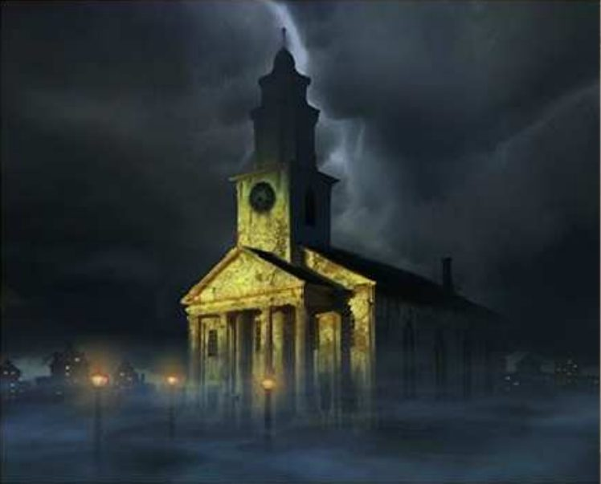

4. Если Алан с сыщиками, он вырежет новую руну на копии за 1d3+1 раунда. Если сыщики его не взяли, это должен сделать кто-то из них. На это уйдёт 1d3+2 раунда, и нужна проверка Искусства/ремесла, чтобы вырезать руну правильно. При провале можно продолжать работу, добавив ещё 1d3 раунда.
5. Каждый раунд бросайте, не появилась ли в разломе новая тварь, пытающаяся вырваться. Пользуйтесь таблицей «Случайные встречи у разлома в Бездну» на с. 71.

    *Прим. перев.: так в оригинале; таблица — на с. 69.*

6. Если выпавшая тварь пытается прорваться, она проходит проверку сопротивления: её МОЩ против общей МОЩ всех заклинателей. Если побеждает сыщик, тварь остаётся запечатанной.
7. Если тварь выигрывает проверку сопротивления или чтецов не осталось, тварь может вырваться из Бездны. В первый раунд после прорыва некоторые твари дезориентированы и не могут нападать. После первого раунда тварь нападает как обычно. Остальные, впервые увидев вырвавшуюся тварь, проходят проверки Рассудка. Твари нападают на самого опасного человека рядом или, если у них мало ПЗ, могут прыгнуть обратно в разлом. Как ведёт себя каждая тварь — на с. 72 и 73.
8. Если все бегут от тварей или все сошли с ума, твари разбредаются по городу.
9. Если сыщикам приходится начать обряд заново, они снова платят пункты магии и Рассудка.
10. Когда копия ядра готова, её можно вкатить на место, чтобы заткнуть дыру.
11. Ещё игрокам нужна успешная проверка Взрывчатки, чтобы обезвредить ядро. Кристина Смит обезвреживает ядро автоматически.

На этом мини-модуль заканчивается. Если он ведётся в составе модуля «Звезда на берегу», преподобный ответит на все вопросы сыщиков и даст им приют.

Если сценарий ведётся как отдельное задание, сыщикам следует заплатить, а при успехе они получают награду Рассудка.

