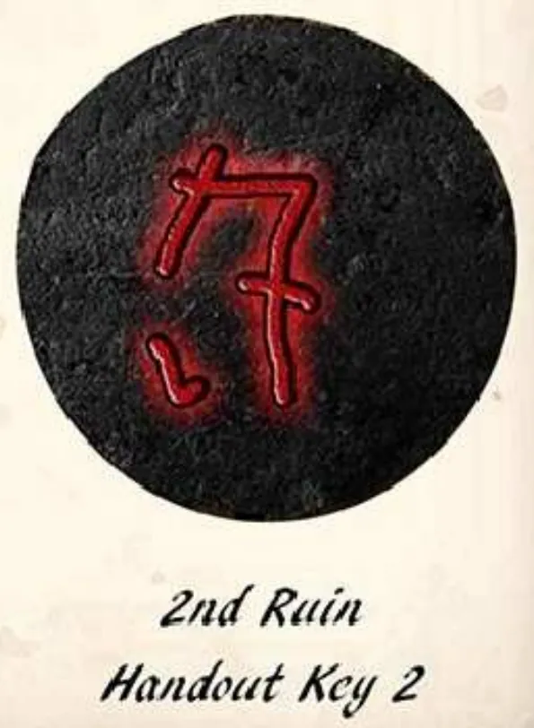

# Заклинание для «Ключа к Бездне»

*«Sigillum Tempus»*, оно же *«Щит-барьер»*

**Стоимость:** 1d3 Рассудка и пунктов магии с каждого заклинателя в начале, +1 пункт магии за раунд с каждого заклинателя.

*Прим. перев.: так в оригинале; не ясно, 1d3 относится и к пунктам магии или только к Рассудку.*

**Число заклинателей:** от 1 до 6.

Если новый заклинатель присоединяется к заклинанию после того, как оно начато, в первый раунд он платит начальную стоимость. Пока заклинание действует, все заклинатели должны всё время видеть место, которое нужно защитить. Если заклинатель теряет его из виду больше чем на 10 секунд, он больше не считается заклинателем. Чтобы снова присоединиться к заклинанию, он должен ещё раз заплатить начальную стоимость.

**Материальные компоненты:** *Ilex* (падуб), *Ruta graveolens* (рута), *Illicium verum* (бадьян) и *Sedum reflexum* (синий очиток).

Падуб найти легко.

Рута — родом с Балканского полуострова, но её можно найти в любой оккультной лавке, в некоторых питомниках и в католических церквях.

Бадьян — родом из Китая и Вьетнама, его можно найти почти в любой аптеке или пекарне (места 11 или 13 в Рокпорте).

*Прим. перев.: так в оригинале; место 13 — парикмахерская Бейли, а пекарня «Сэнди-Бэй» — место 31. Бадьян есть в аптеке «Гранит» (место 11) и в пекарне «Сэнди-Бэй» (место 31).*

Синий очиток найти очень трудно. В Бостоне есть питомник, где он продаётся, но очень дорого. Ещё его можно найти у Дома ведьмы (место 16), где он растёт дико.

Смешайте четыре растения в равных долях, чтобы получилось благовоние. Зажгите благовоние, чтобы начать обряд. Затем заклинатели должны начать петь.

**Песнопение:** «Obice Protector, custodire ab hoc saeculo, ab aliis ensiones Sigillum Tempus».

## Случайные встречи у разлома в Бездну (1d100)

| 1d100 | Что показалось | Рассудок | МОЩ |
|---|---|---|---|
| 01–20 | Ничего | — | — |
| 21–30 | Щупальце хтонийца | 0/1d6 | 90 |
| 31–40 | Бьякхи | 1/1d6 | 50 |
| 41–50 | Цвет из иных миров | 0/1d4 | 60 |
| 51–60 | Бесформенное отродье | 1/1d10 | 50 |
| 61–70 | Охотящиеся ужасы | 0/1d10 | 105 |
| 71–80 | Звёздный вампир | 1/1d10 | 75 |
| 81–90 | Тёмная молодь | 1d3/1d10 | 90 |
| 91–97 | Шоггот | 1d6/1d20 | 65 |
| 98–100 | Открывается Око Азатота | 1d10/2d20+2 | — |

> **Раздатка «Ключ» 2**
>
> Вторая руна

*Прим. перев.: в оригинале подпись «2nd Ruin» — опечатка вместо «2nd Rune» («вторая руна»).*
