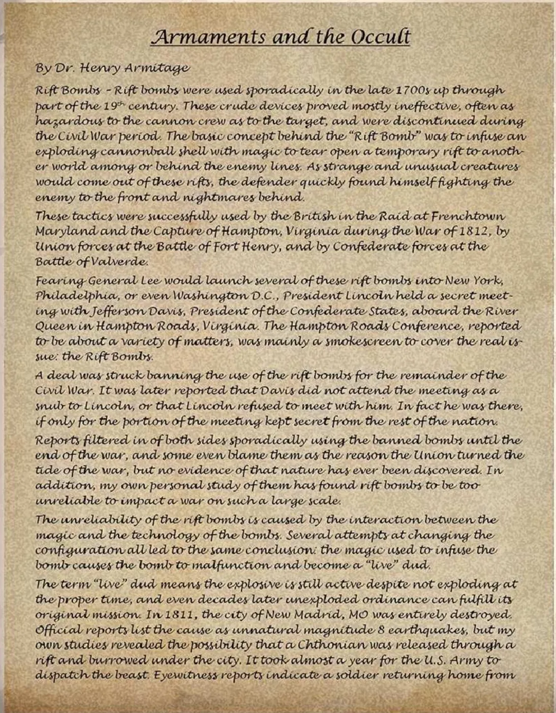

## Раздатка «Ключ» 1, часть 1

> **Раздатка «Ключ» 1, часть 1**
>
> **Вооружение и оккультизм**
>
> *Доктор Генри Армитедж*
>
> *Разломные бомбы. Разломные бомбы время от времени применялись с конца 1700-х годов и в течение части XIX века. Эти грубые устройства оказались по большей части неэффективными, нередко были опасны для пушечного расчёта не меньше, чем для цели, и вышли из употребления в годы Гражданской войны. Основная идея «разломной бомбы» состояла в том, чтобы напитать разрывной пушечный снаряд магией, которая разорвёт временный разлом в другой мир среди вражеских порядков или у них в тылу. Из таких разломов выходили странные и необычные твари, и обороняющийся быстро обнаруживал, что впереди у него враг, а позади — кошмары.*
>
> *Эту тактику успешно применяли британцы при набеге на Френчтаун (Мэриленд) и взятии Хэмптона (Виргиния) во время войны 1812 года, войска Союза — в битве за форт Генри и войска Конфедерации — в битве при Валверде.*
>
> *Опасаясь, что генерал Ли обрушит несколько таких разломных бомб на Нью-Йорк, Филадельфию или даже Вашингтон, президент Линкольн тайно встретился с Джефферсоном Дэвисом, президентом Конфедеративных Штатов, на борту «Ривер Куин» в Хэмптон-Роудс (Виргиния). Конференция в Хэмптон-Роудс, на которой, как сообщалось, обсуждали самые разные вопросы, была главным образом дымовой завесой, скрывавшей настоящий предмет переговоров — разломные бомбы.*
>
> *Стороны договорились запретить разломные бомбы до конца Гражданской войны. Позднее сообщалось, что Дэвис не явился на встречу, чтобы унизить Линкольна, или что Линкольн отказался с ним встречаться. На самом деле Дэвис там был — пусть только на той части встречи, которую скрыли от остальной страны.*
>
> *Поступали сведения, что обе стороны время от времени применяли запрещённые бомбы до самого конца войны, а кое-кто даже считает их причиной перелома в войне в пользу Союза, но никаких доказательств этого так и не нашлось. Кроме того, моё собственное исследование показало, что разломные бомбы слишком ненадёжны, чтобы повлиять на войну такого размаха.*
>
> *Ненадёжность разломных бомб вызвана взаимодействием магии и техники бомб. Несколько попыток изменить устройство привели к одному выводу: магия, которой напитана бомба, вызывает её неисправность, и бомба становится «живым» неразорвавшимся снарядом.*
>
> *«Живой» неразорвавшийся снаряд — это взрывчатка, которая всё ещё действует, хотя и не взорвалась в нужный момент; даже десятилетия спустя неразорвавшийся боеприпас может выполнить своё изначальное назначение. В 1811 году город Нью-Мадрид (Миссури) был полностью разрушен. Официальные отчёты называют причиной необычные землетрясения магнитудой 8, но мои собственные исследования показали, что, возможно, через разлом вырвался хтониец и зарылся под город. Армии США понадобился почти год, чтобы покончить с чудовищем. По словам очевидцев, солдат, вернувшийся домой после этой операции…*
