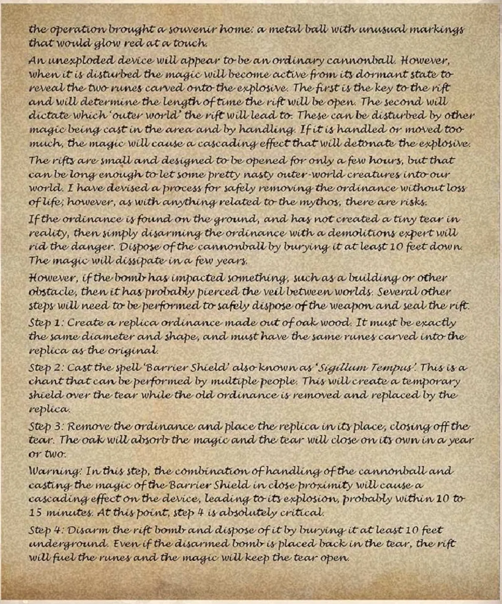

## Раздатка «Ключ» 1, часть 2

> **Раздатка «Ключ» 1, часть 2**
>
> *…привёз сувенир: металлический шар с необычными знаками, которые светились красным от прикосновения.*
>
> *Неразорвавшееся устройство с виду кажется обычным пушечным ядром. Однако, если его потревожить, магия пробуждается от спячки и проявляет две руны, вырезанные на снаряде. Первая — ключ к разлому: она определяет, как долго разлом будет открыт. Вторая указывает, в какой «внешний мир» ведёт разлом. Их могут нарушить другие заклинания, творимые поблизости, и обращение со снарядом. Если снаряд слишком много трогать или двигать, магия вызовет цепную реакцию, и взрывчатка сдетонирует.*
>
> *Разломы невелики и рассчитаны лишь на несколько часов, но и этого может хватить, чтобы в наш мир проникли весьма мерзкие создания из внешних миров. Я разработал способ безопасно извлечь боеприпас без человеческих жертв; однако, как и всё, что связано с Мифами, это сопряжено с риском.*
>
> *Если боеприпас найден на земле и не проделал крошечного разрыва в реальности, достаточно поручить подрывнику обезвредить его — и опасность устранена. Избавьтесь от ядра, закопав его не меньше чем на 3 метра в глубину. Магия рассеется за несколько лет.*
>
> *Если же бомба во что-то попала — например, в здание или другое препятствие, — то она, вероятно, пробила завесу между мирами. Чтобы безопасно избавиться от оружия и запечатать разлом, потребуется выполнить ещё несколько шагов.*
>
> *Шаг 1. Изготовьте копию боеприпаса из дуба. Она должна быть точно того же диаметра и формы, и на ней должны быть вырезаны те же руны, что и на оригинале.*
>
> *Шаг 2. Сотворите заклинание «Щит-барьер», известное также как «Sigillum Tempus». Это песнопение, которое могут исполнять несколько человек. Оно создаст временный щит над разрывом, пока старый боеприпас вынимают и заменяют копией.*
>
> *Шаг 3. Выньте боеприпас и поставьте на его место копию, закрыв разрыв. Дуб впитает магию, и разрыв закроется сам через год-два.*
>
> *Предупреждение: на этом шаге обращение с ядром вкупе с магией Щита-барьера, творимой совсем рядом, вызовет в устройстве цепную реакцию, которая приведёт к взрыву — вероятно, в течение 10–15 минут. В этот момент шаг 4 абсолютно необходим.*
>
> *Шаг 4. Обезвредьте разломную бомбу и избавьтесь от неё, закопав не меньше чем на 3 метра под землю. Даже если обезвреженную бомбу вставить обратно в разрыв, разлом будет питать руны, и магия не даст разрыву закрыться.*
