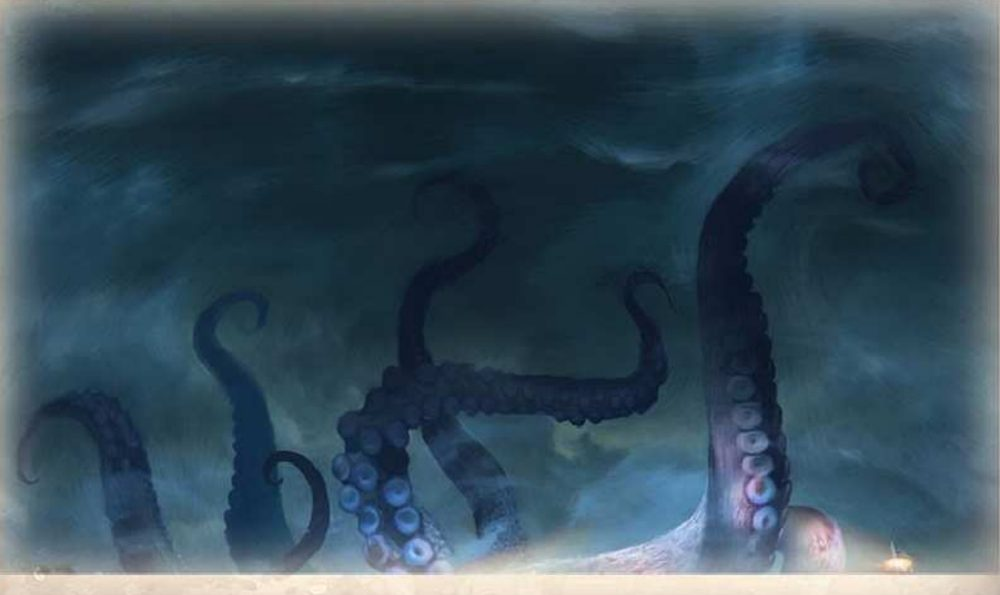

- **Око Азатота.** Вы удостоились незавидной чести привлечь внимание Азатота. К счастью для вас, ваш жалкий мир его не заинтересует, и он вернётся ко сну. Прорваться сквозь заслон он не попытается, но его взгляд может свести людей с ума. Кроме того, взглянет он лишь однажды. Если этот результат выпадет второй раз, считайте, что ничего не произошло.

Подробности некоторых особых атак всех перечисленных здесь тварей — в главе 14 «Книги хранителя» «Зова Ктулху» («Чудовища, звери и чуждые боги»).

Игрокам нужно, чтобы хотя бы один человек продолжал заклинание, иначе твари смогут просто проходить без всякой проверки сопротивления. Каждый раунд проверяйте, что появилось.

Если попытаться снова запечатать разрыв живым ядром, оно взорвётся, открыв огромный разлом, сквозь который может пролезть любая из этих тварей — даже хтониец или тёмная молодь (но не Азатот). Если вставить ядро обратно после того, как его обезвредили, оно удержит разлом закрытым несколько недель, после чего разрыв всё равно откроется и станет разломом.

Если вставить копию без нужных знаков, она провалится в разрыв и пропадёт. Если принять все меры, чтобы этого не случилось, она просто не запечатает разрыв. Если на копии вырезаны правильные руны, она запечатает разрыв, и разлом закроется через несколько лет.

Если разрыв запечатан, а тварь осталась по эту сторону, её придётся убить или как-то с ней справиться.

