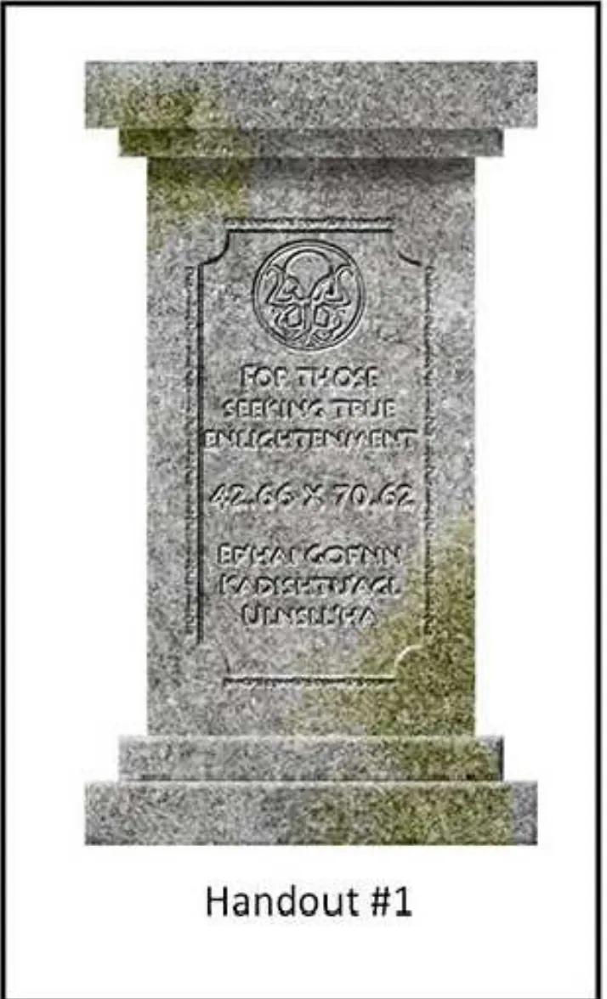
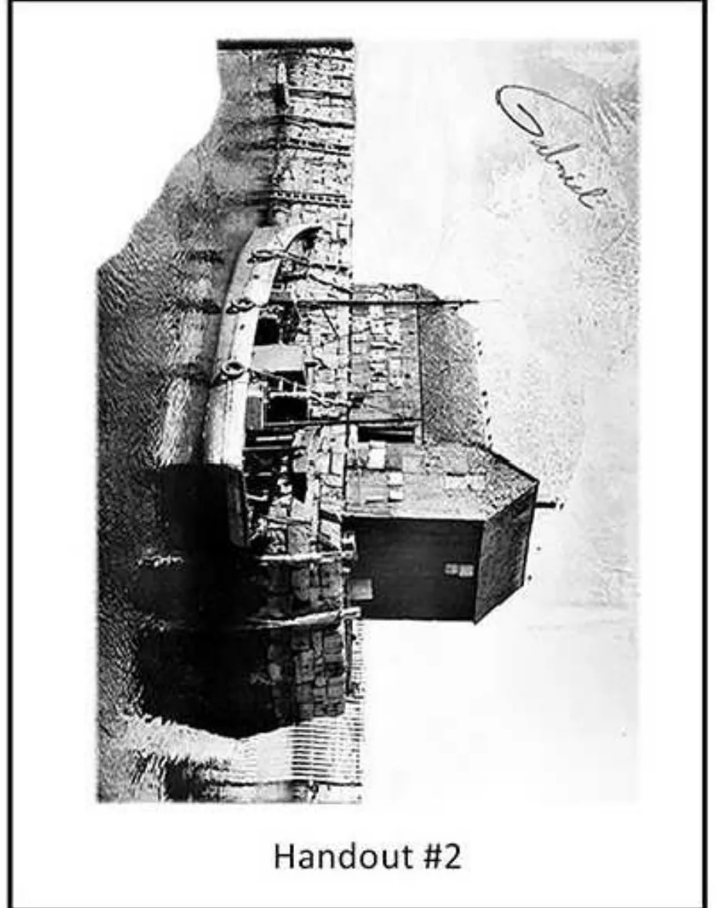
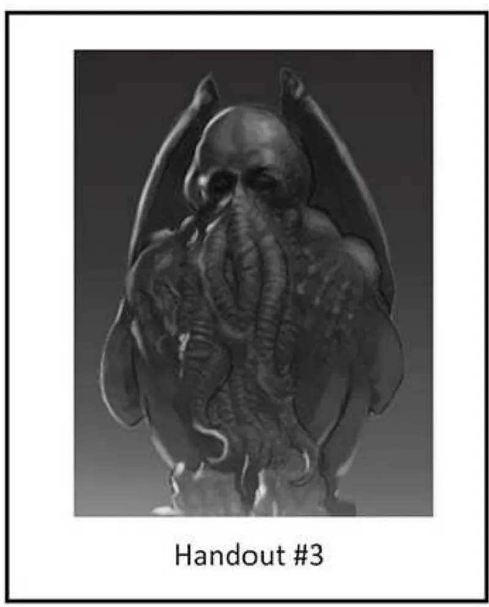
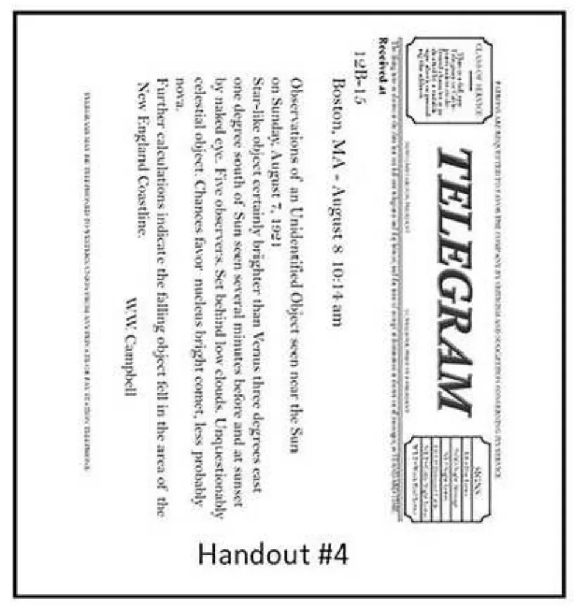

# Раздатки

## Раздатка 1

> **Раздатка 1**
>
> *Гранитный постамент со знаком Ктулху и выбитой надписью:*
>
> ДЛЯ ИЩУЩИХ ИСТИННОГО ПРОСВЕТЛЕНИЯ
>
> 42.66 X 70.62
>
> EP’HAI GOF’NN KADISHTU’AGL ULNSLL’HA

## Раздатка 2

> **Раздатка 2**
>
> *Фотооткрытка: сарай на краю каменного причала. Подпись от руки:* Gabriel (Габриэль)

<!-- -->

## Раздатка 3

> **Раздатка 3**
>
> *Рисунок: статуя Ктулху — крылатая фигура со щупальцами на лице, сидящая на постаменте.*

## Раздатка 4

> **Раздатка 4**
>
> **ТЕЛЕГРАММА**
>
> Принята: 12B-15
>
> Бостон, Массачусетс — 8 августа, 10:14
>
> Наблюдения неопознанного объекта вблизи Солнца в воскресенье, 7 августа 1921 года
>
> Звездообразный объект, определённо ярче Венеры, в трёх градусах к востоку и одном градусе к югу от Солнца наблюдался невооружённым глазом за несколько минут до заката и на закате. Пять наблюдателей. Зашёл за низкие облака. Несомненно небесный объект. Вероятнее всего, ядро яркой кометы, менее вероятно — новая звезда.
>
> Дальнейшие расчёты показывают, что падающий объект упал в районе побережья Новой Англии.
>
> У. У. Кэмпбелл

*Мелкий служебный текст бланка телеграммы на скане не читается.*
