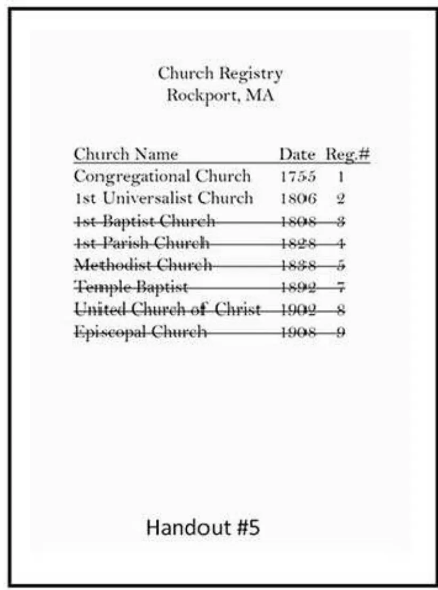
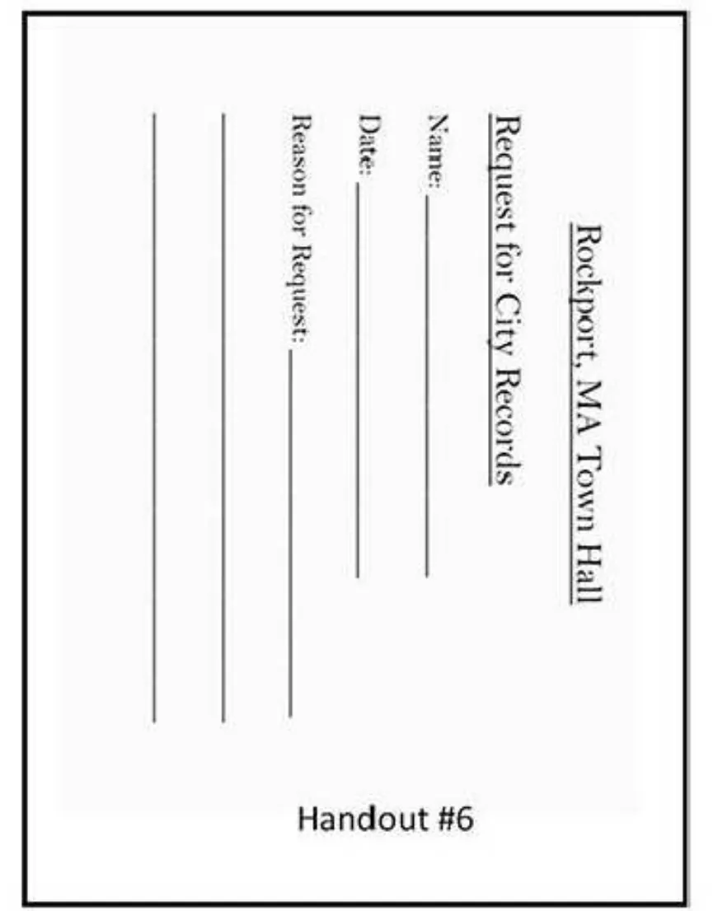
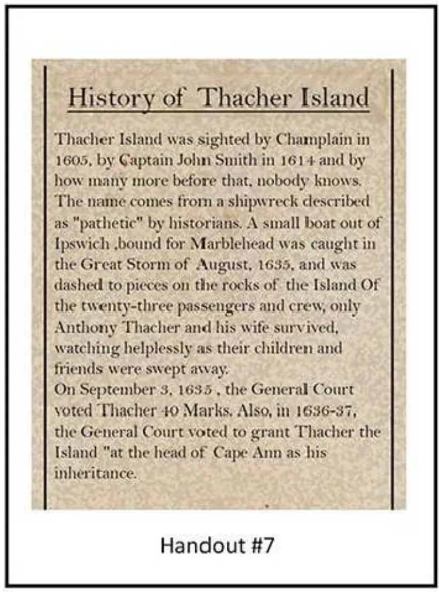
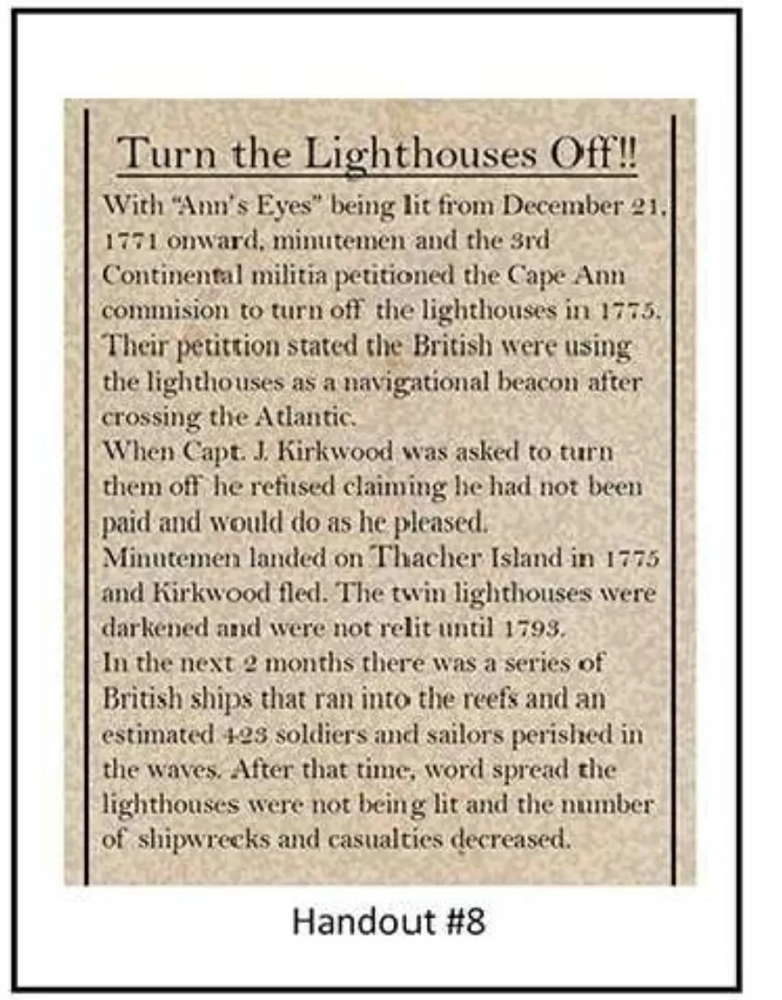

## Раздатка 5

> **Раздатка 5**
>
> **Реестр церквей**
> Рокпорт, Массачусетс
>
> | Название церкви | Дата | Рег. № |
> |---|---|---|
> | Конгрегационалистская церковь | 1755 | 1 |
> | 1-я Универсалистская церковь | 1806 | 2 |
> | <del>1-я Баптистская церковь</del> | <del>1808</del> | <del>3</del> |
> | <del>1-я Приходская церковь</del> | <del>1828</del> | <del>4</del> |
> | <del>Методистская церковь</del> | <del>1838</del> | <del>5</del> |
> | <del>Баптистский храм</del> | <del>1892</del> | <del>7</del> |
> | <del>Объединённая церковь Христа</del> | <del>1902</del> | <del>8</del> |
> | <del>Епископальная церковь</del> | <del>1908</del> | <del>9</del> |

## Раздатка 6

> **Раздатка 6**
>
> **Ратуша Рокпорта, Массачусетс**
>
> Запрос на городские документы
>
> Имя: ____________
>
> Дата: ____________
>
> Причина запроса: ____________

## Раздатка 7

> **Раздатка 7**
>
> **История острова Тэтчер**
>
> Остров Тэтчер видел Шамплен в 1605 году, капитан Джон Смит — в 1614-м, а сколько людей до них — никто не знает. Название пошло от кораблекрушения, которое историки называют «жалким». Небольшая лодка из Ипсвича, шедшая в Марблхед, попала в Великий шторм августа 1635 года и разбилась о скалы острова. Из двадцати трёх пассажиров и команды выжили только Энтони Тэтчер и его жена, беспомощно смотревшие, как волны уносят их детей и друзей.
>
> 3 сентября 1635 года Генеральный суд присудил Тэтчеру 40 марок. А в 1636–37 годах Генеральный суд постановил отдать Тэтчеру остров «у оконечности мыса Энн» в наследство.

## Раздатка 8

> **Раздатка 8**
>
> **Погасите маяки!!**
>
> После того как с 21 декабря 1771 года зажглись «Глаза Энн», минитмены и 3-е континентальное ополчение в 1775 году потребовали от комиссии мыса Энн погасить маяки. В их петиции говорилось, что британцы, пересёкши Атлантику, используют маяки как навигационные ориентиры.
>
> Когда капитана Дж. Кирквуда попросили погасить их, он отказался, заявив, что ему не заплатили и он будет поступать как захочет.
>
> В 1775 году минитмены высадились на острове Тэтчер, и Кирквуд бежал. Маяки-близнецы погасили, и их не зажигали до 1793 года.
>
> В следующие 2 месяца несколько британских кораблей налетели на рифы, и в волнах погибли около 423 солдат и моряков. После этого разнеслась весть, что маяки не горят, и число кораблекрушений и жертв уменьшилось.
