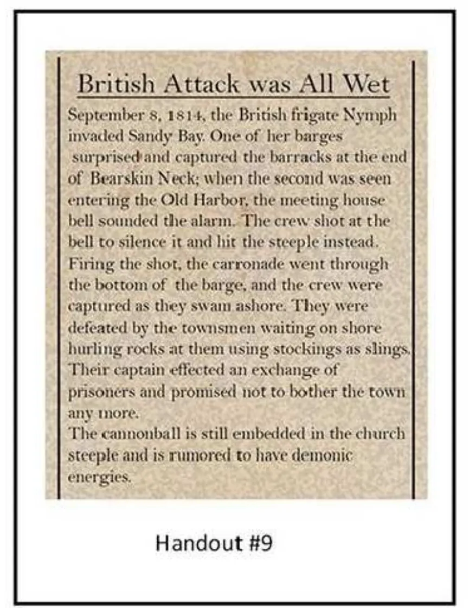
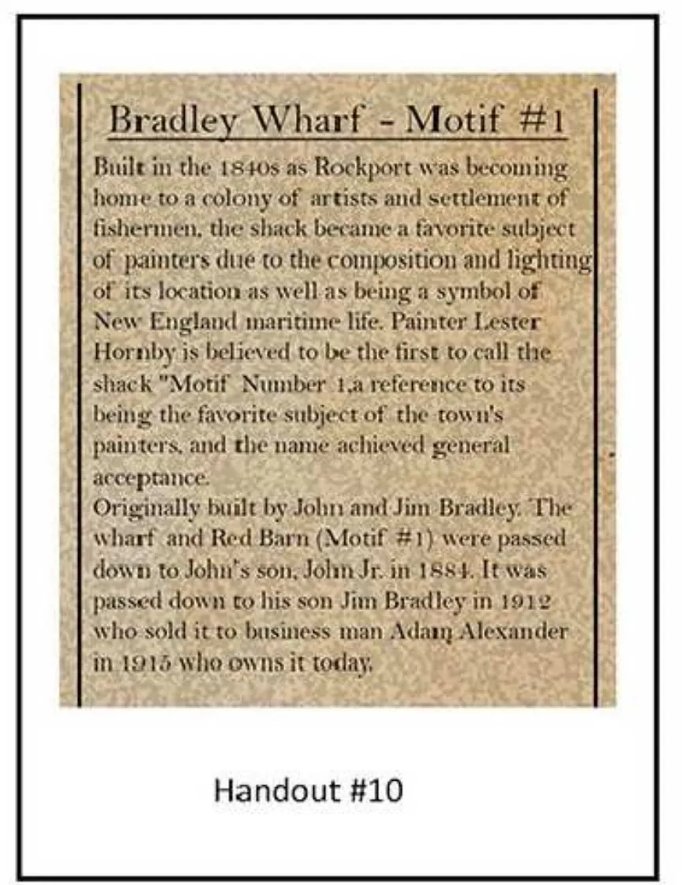
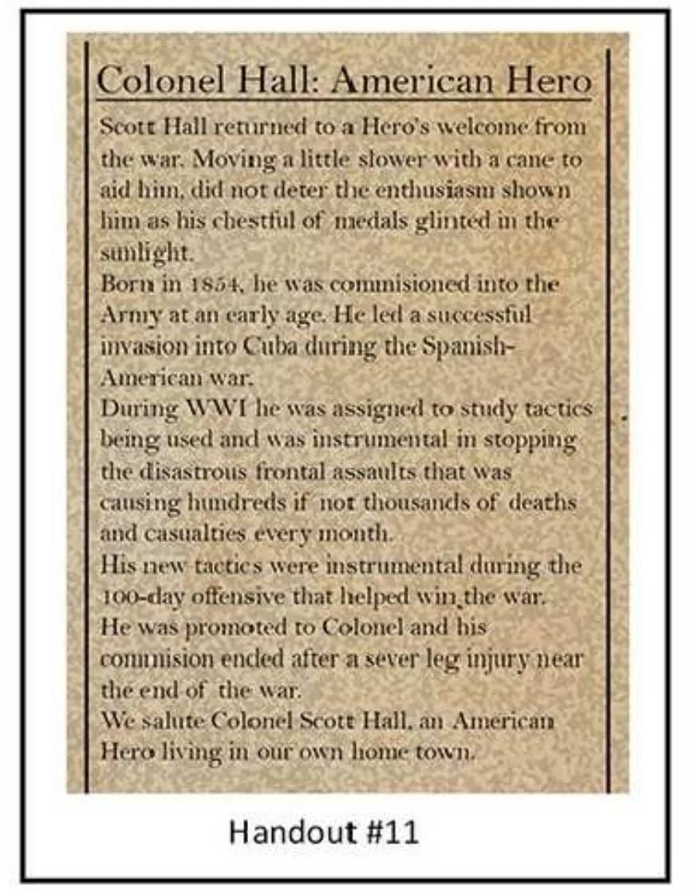
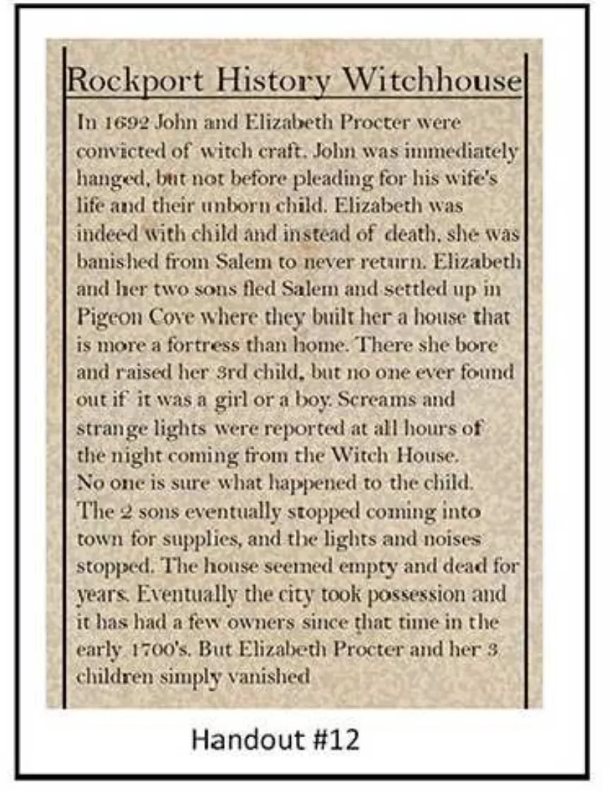

## Раздатка 9

> **Раздатка 9**
>
> **Британская атака села в лужу**
>
> 8 сентября 1814 года британский фрегат «Нимф» вошёл в бухту Сэнди-Бэй. Одна из его шлюпок застала врасплох и захватила казармы на конце Бэрскин-Нек; когда вторую заметили входящей в Старую гавань, колокол молитвенного дома забил тревогу. Команда выстрелила по колоколу, чтобы заставить его замолчать, но попала в шпиль. От выстрела карронада пробила дно шлюпки, и команду взяли в плен, когда она добиралась до берега вплавь. Их одолели горожане, ждавшие на берегу и метавшие в них камни, используя чулки как пращи. Их капитан добился обмена пленными и пообещал больше не трогать город.
>
> Ядро до сих пор сидит в церковном шпиле, и ходят слухи, что в нём таится демоническая сила.

## Раздатка 10

> **Раздатка 10**
>
> **Пристань Брэдли — Мотив № 1**
>
> Построенный в 1840-х, когда Рокпорт становился домом колонии художников и посёлком рыбаков, сарай стал любимым сюжетом живописцев благодаря композиции и освещению места, а также как символ морской жизни Новой Англии. Считается, что первым назвал сарай «Мотив номер 1» художник Лестер Хорнби — намекая, что это любимый сюжет городских художников, — и название прижилось.
>
> Построили его Джон и Джим Брэдли. В 1884 году причал и Красный сарай («Мотив № 1») перешли к сыну Джона, Джону-младшему. В 1912 году они перешли к его сыну Джиму Брэдли, который в 1915 году продал их предпринимателю Адаму Александеру — тот владеет ими и сегодня.

## Раздатка 11

> **Раздатка 11**
>
> **Полковник Холл: американский герой**
>
> Скотт Холл вернулся с войны, встреченный как герой. Он двигался чуть медленнее, опираясь на трость, но это не умерило восторга, с которым его встречали, пока на солнце сверкала его грудь, полная медалей.
>
> Родившись в 1854 году, он рано получил офицерский чин в армии. Во время Испано-американской войны он возглавил успешное вторжение на Кубу.
>
> В Первую мировую войну ему поручили изучать применяемую тактику, и он сыграл важную роль в прекращении гибельных лобовых атак, уносивших сотни, если не тысячи жизней убитыми и ранеными каждый месяц.
>
> Его новая тактика сыграла важную роль во время Стодневного наступления, которое помогло выиграть войну.
>
> Он был произведён в полковники, и его служба закончилась после тяжёлого ранения ноги в конце войны.
>
> Мы салютуем полковнику Скотту Холлу — американскому герою, живущему в нашем родном городе.

## Раздатка 12

> **Раздатка 12**
>
> **История Рокпорта: Дом ведьмы**
>
> В 1692 году Джона и Элизабет Проктор осудили за колдовство. Джона сразу повесили, но прежде он молил пощадить жену и их нерождённое дитя. Элизабет действительно была беременна, и вместо казни её навсегда изгнали из Салема. Элизабет с двумя сыновьями бежала из Салема и поселилась в Пиджен-Коув, где сыновья построили ей дом, больше похожий на крепость, чем на жилище. Там она родила и вырастила третьего ребёнка, но так никто и не узнал, девочка это или мальчик. В любое время ночи из Дома ведьмы доносились крики и виднелись странные огни.
>
> Никто точно не знает, что стало с ребёнком.
>
> Двое сыновей со временем перестали приходить в город за припасами, и огни и шум прекратились. Годами дом казался пустым и мёртвым. В конце концов город забрал его, и с начала 1700-х у него сменилось несколько владельцев. Но Элизабет Проктор и трое её детей просто исчезли.
