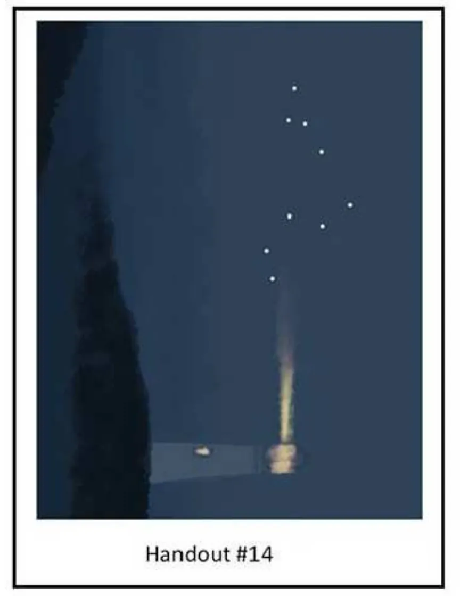
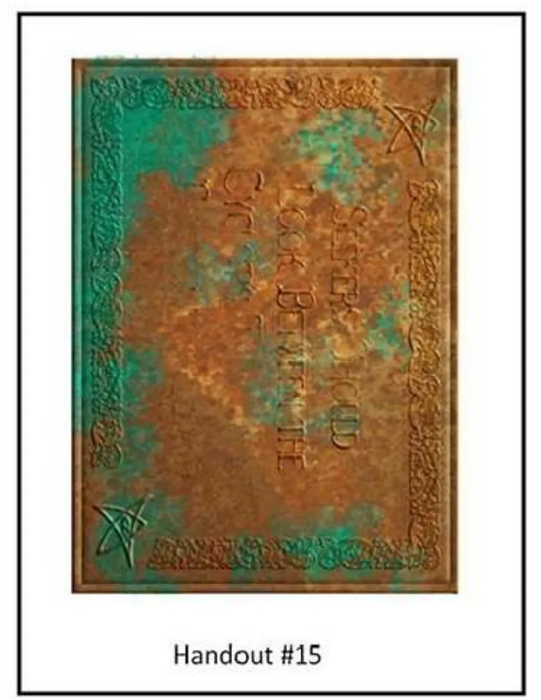
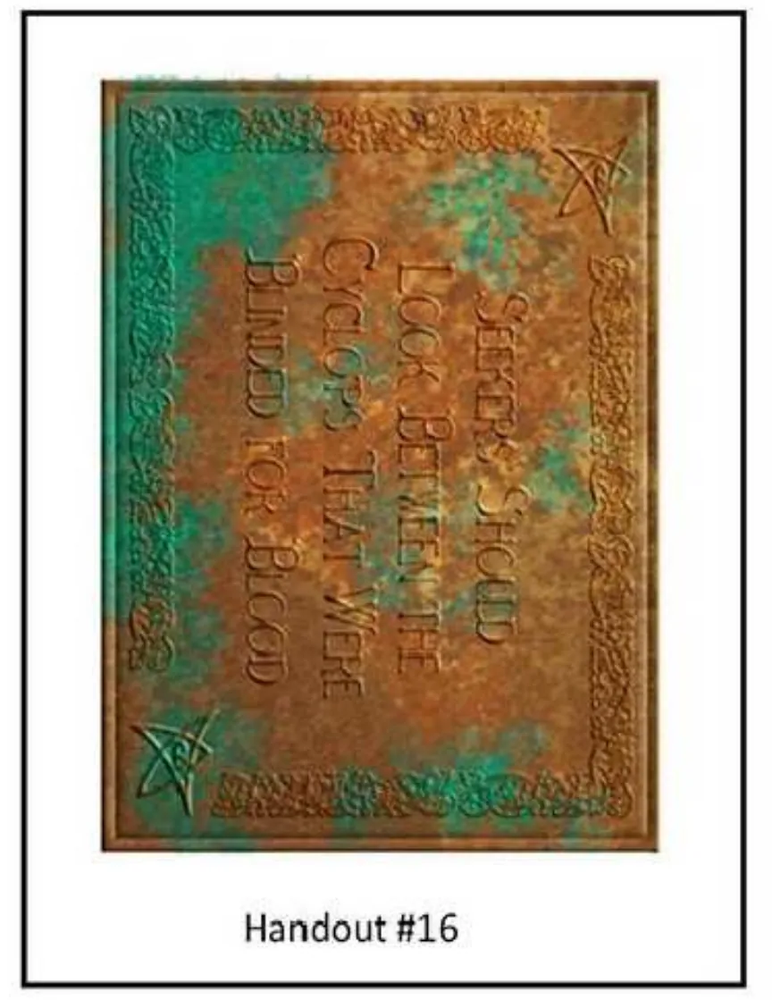

## Раздатка 13

> **Раздатка 13**
>
> *Знак — три «Y».*
>
> **ДЛЯ ИЩУЩИХ ИСТИННОГО ПРОСВЕТЛЕНИЯ**
>
> Посетите Часовню созерцания
> и Церковь Господа нашего,
> Дарующего тайны, в церкви Олд-Слуп.

*В оригинале — «Church of our Lord, GoS»: «GoS» — сокращение «Granter of Secrets», «Дарующий тайны».*

## Раздатка 14

> **Раздатка 14**
>
> *Рисунок: ночное небо над морем, луч маяка и узор из девяти звёзд.*

## Раздатка 15

> **Раздатка 15**
>
> *Позеленевшая бронзовая табличка со знаком, похожим на Знак Старших богов, в углах; надпись почти стёрта:*
>
> ИЩУЩИМ СЛЕДУЕТ ИСКАТЬ МЕЖДУ ЦИКЛ…

## Раздатка 16

> **Раздатка 16**
>
> *Та же табличка, надпись читается целиком:*
>
> ИЩУЩИМ СЛЕДУЕТ ИСКАТЬ МЕЖДУ ЦИКЛОПАМИ, КОТОРЫХ ОСЛЕПИЛИ РАДИ КРОВИ
