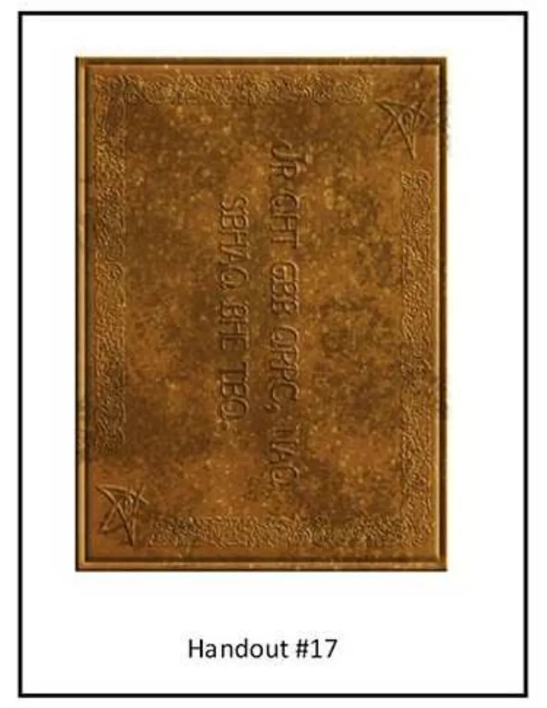
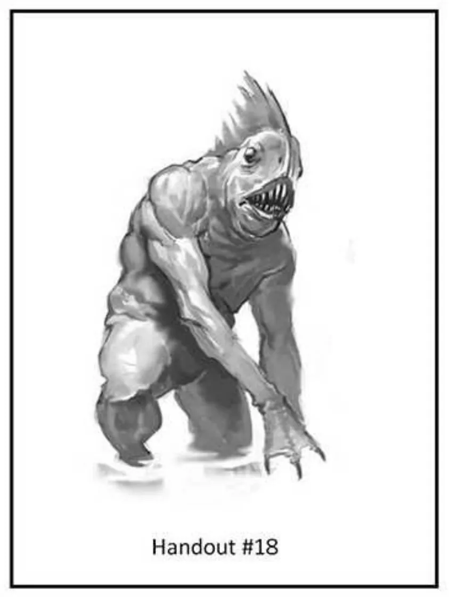
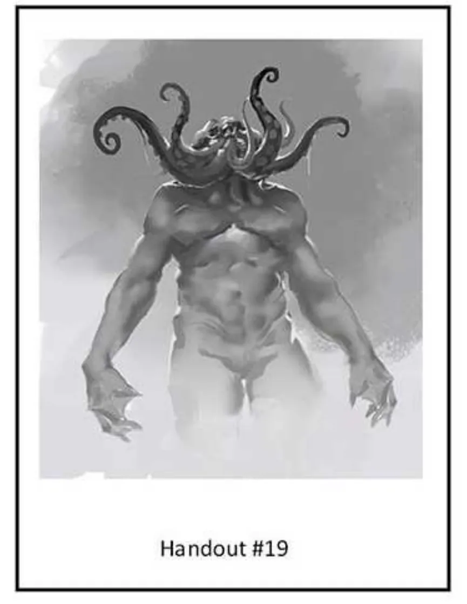
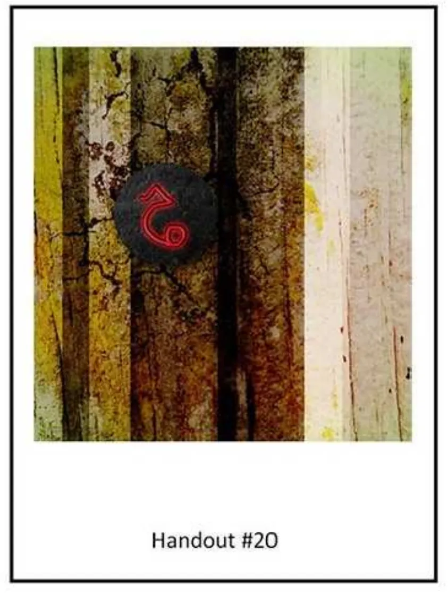

## Раздатка 17

> **Раздатка 17**
>
> *Бронзовая табличка со знаками по углам; надпись зашифрована (сдвиг букв ROT13), поэтому дана как в оригинале:*
>
> JR QHT GBB QRRC, NAQ SBHAQ BHE TBQ.
>
> *(Расшифровка: «Мы копали слишком глубоко и нашли нашего бога».)*

*Прим. перев.: в тексте места 6 (с. 22) шифр напечатан иначе — «Sr ght gbb qrrc, nag sbhaq bhe tbq.»; верный ROT13 — вариант на рисунке раздатки.*

## Раздатка 18

> **Раздатка 18**
>
> *Рисунок: глубоководный — сгорбленная рыбоподобная тварь с плавником на голове и острыми зубами.*

## Раздатка 19

> **Раздатка 19**
>
> *Рисунок: звёздное отродье — человекоподобный торс с головой из извивающихся щупалец, встающий из тумана.*

## Раздатка 20

> **Раздатка 20**
>
> *Рисунок: красный светящийся знак на тёмном круге в выщербленной поверхности.*

*Прим. перев.: в тексте книги раздатка 20 нигде не упомянута. Знак тот же, что у первой руны на ядре в «Ключе к Бездне» (рисунок на с. 66).*
