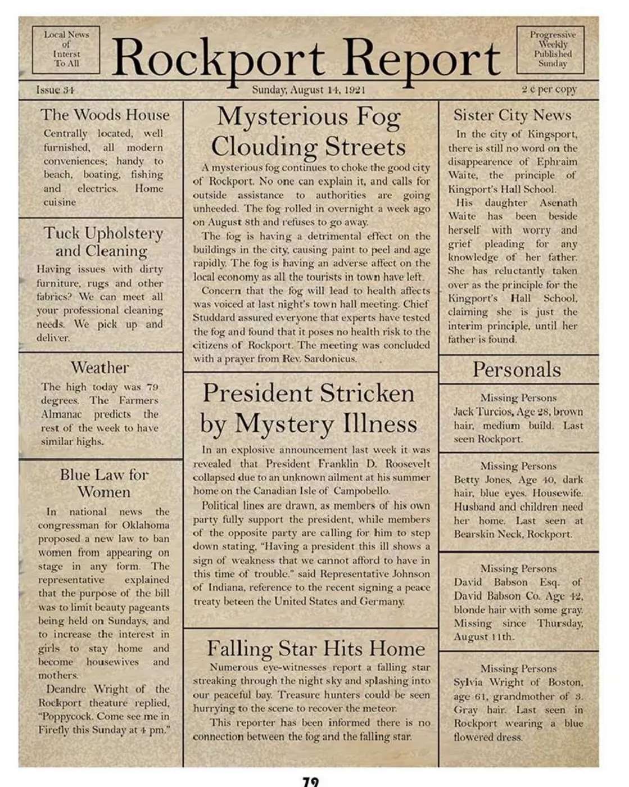

## «Рокпорт рипорт», выпуск 34

> **«РОКПОРТ РИПОРТ»**
>
> *Местные новости, интересные всем • Прогрессивный еженедельник, выходит по воскресеньям*
>
> Выпуск 34 • Воскресенье, 14 августа 1921 года • 2 цента
>
> **Дом Вудса**
>
> В центре города, хорошо обставлен, все современные удобства; рядом пляж, лодки, рыбалка, электричество. Домашняя кухня.
>
> **Обивка и чистка Така**
>
> Проблемы с грязной мебелью, коврами и другими тканями? Мы удовлетворим все ваши потребности в профессиональной чистке. Заберём и доставим.
>
> **Погода**
>
> Сегодня днём было до 26 °C. Фермерский альманах обещает такую же жару до конца недели.
>
> **Синий закон для женщин**
>
> Из национальных новостей: конгрессмен от Оклахомы предложил новый закон, запрещающий женщинам появляться на сцене в любом виде. Представитель пояснил, что цель законопроекта — ограничить конкурсы красоты по воскресеньям и пробудить у девушек интерес к тому, чтобы оставаться дома и становиться домохозяйками и матерями.
>
> Деандра Райт из Театра Рокпорта ответила: «Чепуха. Приходите посмотреть на меня в „Светлячке“ в это воскресенье в 4 часа дня».
>
> **Таинственный туман окутал улицы**
>
> Таинственный туман продолжает душить добрый город Рокпорт. Никто не может его объяснить, а призывы к властям о помощи извне остаются без ответа. Туман накатил за одну ночь неделю назад, 8 августа, и не уходит.
>
> Туман губительно действует на здания города: краска облезает, они быстро стареют. Туман вредит и местной экономике: все туристы уехали.
>
> На вчерашнем городском собрании высказывались опасения, что туман вредит здоровью. Шеф Стаддард заверил всех, что эксперты проверили туман и он не опасен для жителей Рокпорта. Собрание завершилось молитвой преподобного Сардоникуса.
>
> **Президент сражён таинственной болезнью**
>
> На прошлой неделе было сделано громкое заявление: президент Франклин Д. Рузвельт упал без сил из-за неизвестного недуга в своём летнем доме на канадском острове Кампобелло.
>
> Политические позиции определились: члены его партии полностью поддерживают президента, а члены противоположной призывают его уйти, заявляя: «Президент, так тяжело больной, — признак слабости, которую мы не можем себе позволить в это трудное время», — сказал представитель Джонсон от Индианы, имея в виду недавнее подписание мирного договора между Соединёнными Штатами и Германией.
>
> **Падающая звезда угодила прямо к нам**
>
> Многочисленные очевидцы сообщают о падающей звезде, которая пронеслась по ночному небу и упала в нашу мирную бухту. Видели, как охотники за сокровищами спешили на место, чтобы найти метеорит.
>
> Этого репортёра заверили, что туман и падающая звезда никак не связаны.
>
> **Вести из города-побратима**
>
> В Кингспорте по-прежнему нет вестей об исчезновении Эфраима Уэйта, директора кингспортской Холл-скул. Его дочь Асенат Уэйт вне себя от тревоги и горя и просит сообщить любые сведения об отце. Она неохотно заняла пост директора кингспортской Холл-скул, утверждая, что она лишь временный директор, пока не найдётся отец.
>
> **Частные объявления**
>
> *Пропал человек.* Джек Турсиос, 28 лет, каштановые волосы, среднего телосложения. В последний раз видели в Рокпорте.
>
> *Пропал человек.* Бетти Джонс, 40 лет, тёмные волосы, голубые глаза. Домохозяйка. Муж и дети ждут её дома. В последний раз видели на Бэрскин-Нек в Рокпорте.
>
> *Пропал человек.* Дэвид Бэбсон, эсквайр, «Дэвид Бэбсон Ко.», 42 года, светлые волосы с проседью. Пропал с четверга, 11 августа.
>
> *Пропал человек.* Сильвия Райт из Бостона, 61 год, бабушка троих внуков. Седые волосы. В последний раз видели в Рокпорте в синем платье в цветочек.
