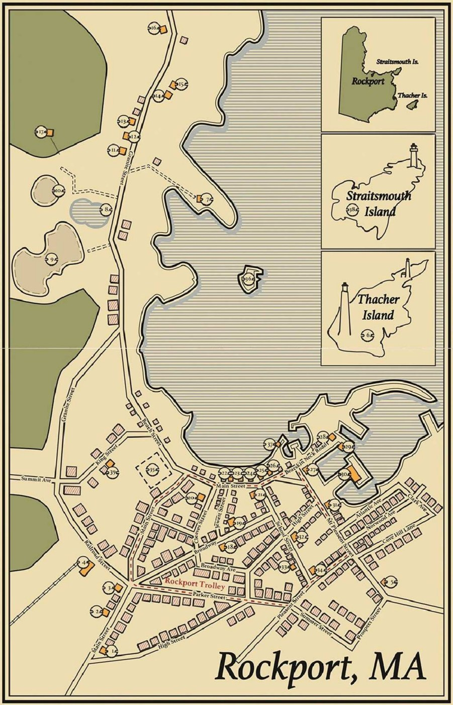

# Карты

## Карта Хранителя

*Надписи на карте: «Keeper Map» — карта Хранителя; «Rockport, MA» — Рокпорт, Массачусетс. Врезки: Rockport, Straitsmouth Is., Thacher Is. — Рокпорт, остров Стрейтсмут, остров Тэтчер; Straitsmouth Island — остров Стрейтсмут (место 38); Thacher Island — остров Тэтчер (место 6). Rockport Trolley — трамвай Рокпорта (пунктир). Улицы: Granite Street, Beach Street, King Street, Summit Ave, Main Street, Railroad Street, Cleaves Street, Jewett Street, Broadway, Broadway Ave, Parker Street, High Street, School Street, Mt Pleasant Street, Pleasant Street, Summer Street, Prospect Street, Atlantic Ave, Norwood Ave, Cove Hill Lane, Clark Ave, Bearskin Neck Road.*

*Та же карта, что в начале описания города (с. 14–15); картинка — из той же записи базы.*

**Ключ** *(на карте только номера; названия — по главе о городе)*

| № | Место |
|---|---|
| 1 | Полицейский участок Рокпорта |
| 2 | Мясная лавка «Гриффон» |
| 3 | Скобяная лавка Смита |
| 4 | Железнодорожная станция Рокпорта |
| 5 | Дом Вудса |
| 6 | Маяки острова Тэтчер |
| 7 | Гранитная компания Рокпорта |
| 8 | Карьер № 1 |
| 9 | Карьер № 2 |
| 10 | Карьер № 3 |
| 11 | Аптека «Гранит» |
| 12 | Контора Дэвида Бэбсона |
| 13 | Парикмахерская Бейли |
| 14 | Часовня Пиджен-Коув |
| 15 | Инструментальная компания Кейп-Энн |
| 16 | Дом ведьмы |
| 17 | Дом старика Дугласа |
| 18 | Почта и телеграф |
| 19 | Ратуша Рокпорта |
| 20 | Церковь универсалистов |
| 21 | Церковь Олд-Слуп |
| 22 | Магазин Джона Тарра |
| 23 | Мемориальный зал Рокпорта |
| 24 | Библиотека Рокпорта |
| 25 | Кафе «Сэнди-Бэй» |
| 26 | Художественная ассоциация Рокпорта |
| 27 | Бэрскин-Нек |
| 28 | Суда и рыбалка братьев Брэдли |
| 29 | Красный сарай («Мотив № 1») |
| 30 | Межштатная рыбная корпорация |
| 31 | Пекарня «Сэнди-Бэй» |
| 32 | Театр Рокпорта |
| 33 | Обивочная мастерская Така |
| 34 | Дом Нэша Филбертона |
| 35 | Кладбище Пэрриш |
| 36 | Остров Сэнди-Бэй-Рок |
| 37 | Рыбацкая пристань |
| 38 | Остров Стрейтсмут |
| 39 | Редакция «Рокпорт рипорт» |
