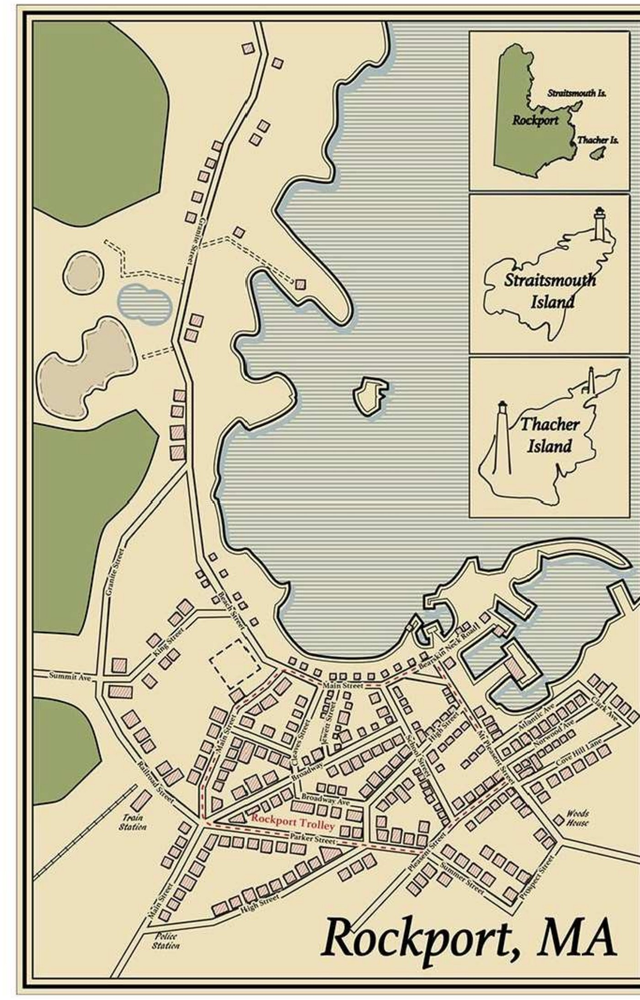

## Карта для игроков

*Надписи на карте: «Player Map» — карта для игроков; «Rockport, MA» — Рокпорт, Массачусетс. Врезки: Rockport, Straitsmouth Is., Thacher Is. — Рокпорт, остров Стрейтсмут, остров Тэтчер; Straitsmouth Island — остров Стрейтсмут; Thacher Island — остров Тэтчер. Подписанные здания: Train Station — железнодорожная станция, Police Station — полицейский участок, Woods House — Дом Вудса. Rockport Trolley — трамвай Рокпорта (пунктир). Улицы — те же, что на карте Хранителя.*
