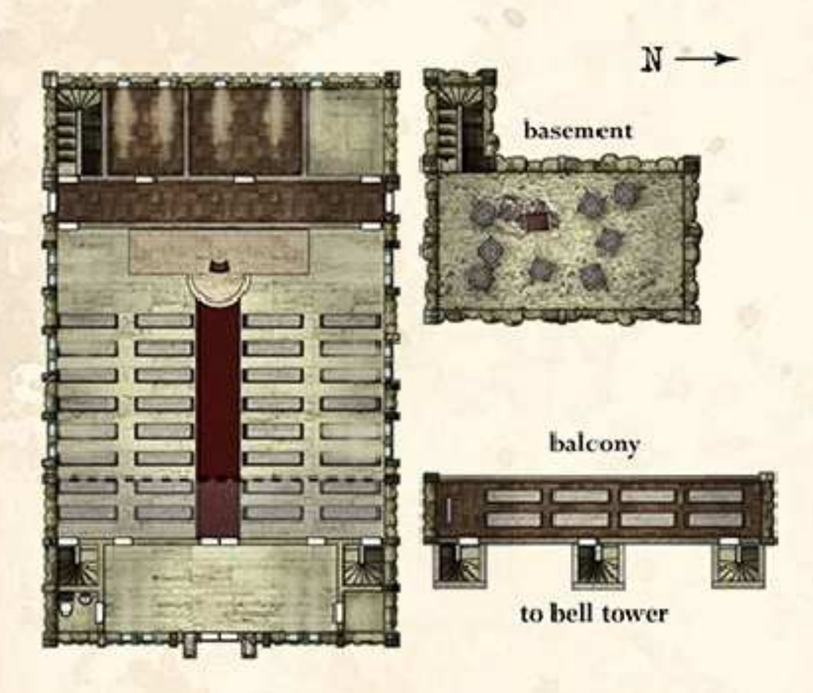
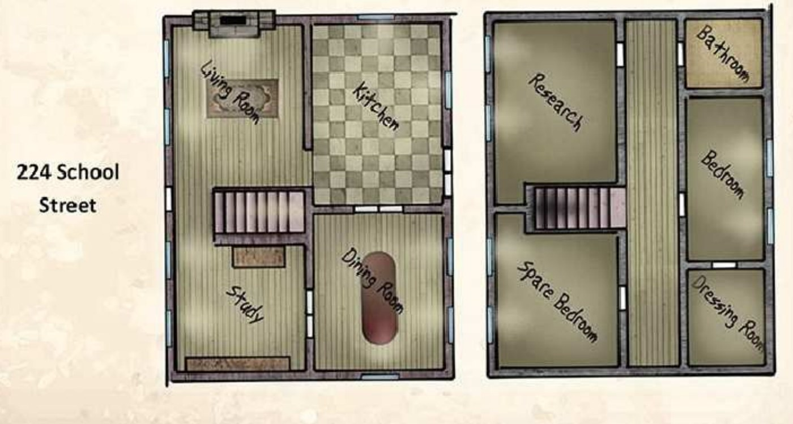
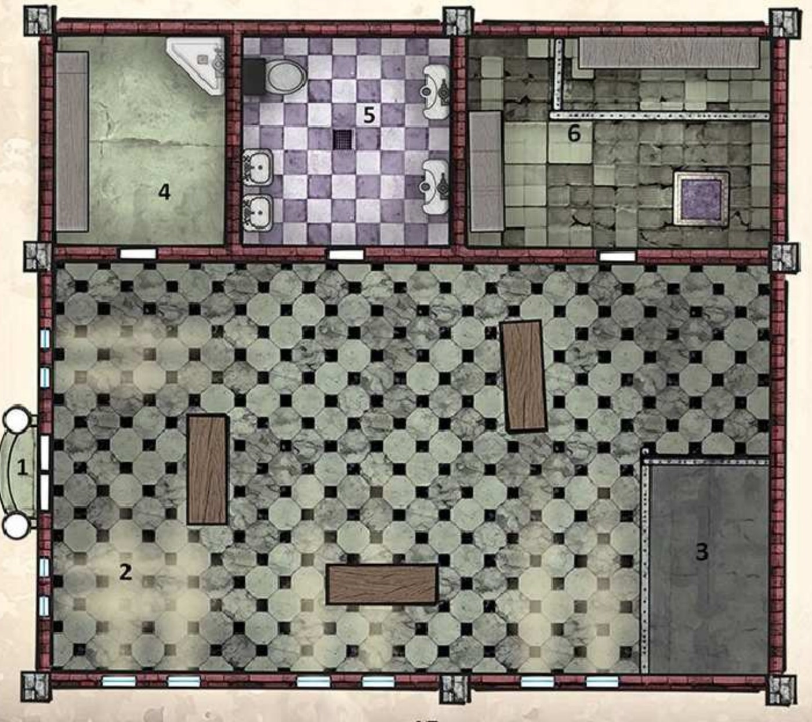

## Церковь Олд-Слуп (место 21)

*Надписи: «Congregational Church, The Old Sloop, Location 21» — конгрегационалистская церковь, церковь Олд-Слуп, место 21; basement — подвал; balcony — балкон; to bell tower — на колокольню; N — север.*

## Дом Нэша Филбертона, Скул-стрит, 224 (место 34)

*Надписи: «224 School Street, Location 34» — Скул-стрит, 224, место 34. Второй этаж: Bathroom — ванная, Bedroom — спальня, Dressing Room — гардеробная, Research — комната для исследований, Spare Bedroom — гостевая спальня. Первый этаж: Kitchen — кухня, Dining Room — столовая, Living Room — гостиная, Study — кабинет.*

## Полицейский участок (место 1)

*Надпись: «Police Station, Location 1» — полицейский участок, место 1.*

*Те же планы, что в описаниях мест 21, 34 и 1; картинки — из тех же записей базы.*
