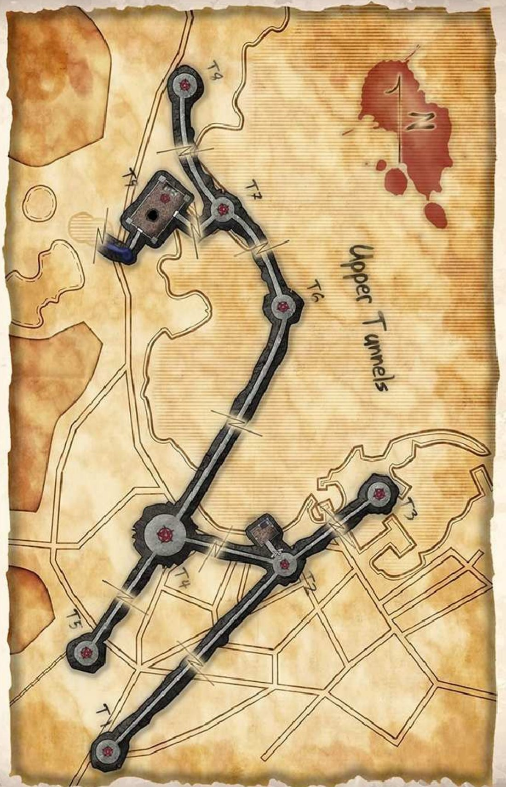
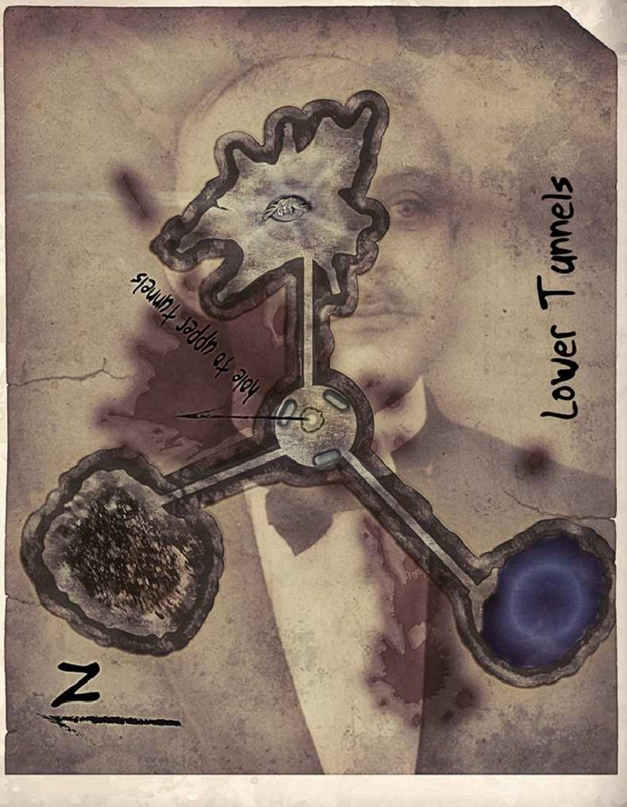

## Верхние туннели

*Надписи: «Upper Tunnels» — Верхние туннели; T1–T9 — камеры (T9 — подземная часовня); N — север. Под туннелями — контур улиц и берега Рокпорта.*

## Нижние туннели

*Надписи: «Lower Tunnels» — Нижние туннели; hole to upper tunnels — дыра в верхние туннели; N — север.*

*Те же карты, что в главах «Верхние туннели» (с. 52) и «Нижние туннели» (с. 57); картинки — из тех же записей базы.*
