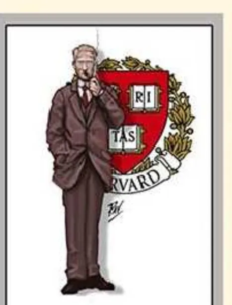

# Готовые сыщики

## Алекс Йеллоп, студент-юрист, 24 года



```stat
СИЛ 60  ВЫН 60  ТЕЛ 55  ЛВК 60  ИНТ 80
НАР 55  МОЩ 50  ОБР 90  Рассудок 50  ПЗ 11
БкУ: нет  Комплекция: 0  Скорость: 9  Удача: 50  ПМ: 10

Бой
Драка      30% (15/6), урон 1d3
Пистолет   30% (15/6), урон по оружию
Уклонение  30%
```

### Навыки

Археология 40%, Вождение автомобиля 60%, Юриспруденция 80%, Работа в библиотеке 75%, Слух 50%,
Наука (химия) 40%, Наука (физика) 40%, Наука (геология) 40%, Наука (биология) 40%, Естествознание 40%,
Средства 45%.

### Предыстория

**Описание:** Аксель — высокий, хорошо одетый студент-юрист в очках. Рыже-светлые волосы аккуратно причёсаны и подстрижены. Обычно его видят в костюме-тройке с галстуком, трубка крепко зажата в зубах.

Аксель окончил с отличием Бостонский университет и сразу поступил в Гарвардскую школу права. В Бостонском университете Аксель набрал много естественнонаучных курсов и верит, что всё можно объяснить наукой.

### Снаряжение

Трубка, сумка с бумагой, пером и чернилами, свод законов.

### Заметки игрока

*Прим. перев.: в заголовке листа — «Alex», в описании трижды — «Axel» (Аксель); так в оригинале.*
