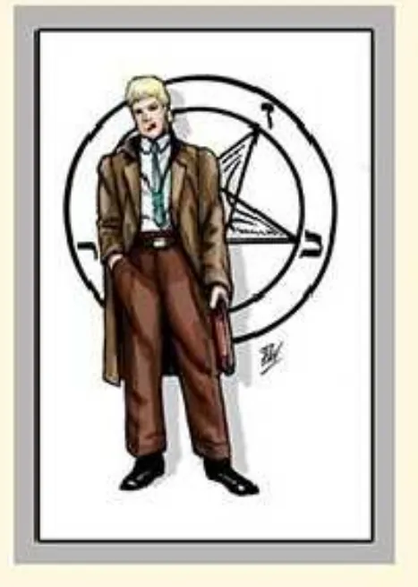

## Александр Хоки, частный сыщик, 32 года



```stat
СИЛ 70  ВЫН 60  ТЕЛ 65  ЛВК 60  ИНТ 60
НАР 75  МОЩ 55  ОБР 60  Рассудок 55  ПЗ 12
БкУ: +1d4  Комплекция: 1  Скорость: 8  Удача: 55  ПМ: 11

Бой
Драка      60% (30/12), урон 1d3+БкУ
Пистолет   60% (30/12), урон по оружию
Дробовик   40% (20/8), урон по оружию
Уклонение  30%
```

### Навыки

Обаяние 40%, Маскировка 50%, Красноречие 45%, Запугивание 50%,
Взлом 45%, Оккультизм 30%, Психология 35%, Внимание 60%,
Средства 25%.

### Предыстория

**Описание:** Александр высок и хорошо сложён, у него светлые волосы и голубые глаза.

Бывший полицейский, он был выгнан со службы за то, что настаивал на существовании демонов и чудовищ. Не то чтобы с ним кто-то спорил — просто он всё время упоминал их в официальных рапортах и брался за каждое странное дело, попадавшее в участок.

Став частным сыщиком, Александр продолжил с того же места: он идёт по каждому следу, какой может найти, преследуя зло, в существовании которого уверен.

### Снаряжение

Помповый дробовик 12-го калибра с обрезанным стволом (10 патронов), урон 4d6/2d6/1d6.
Револьвер .45 (12 патронов), урон 1d10+2.
4 доллара наличными.

### Заметки игрока
