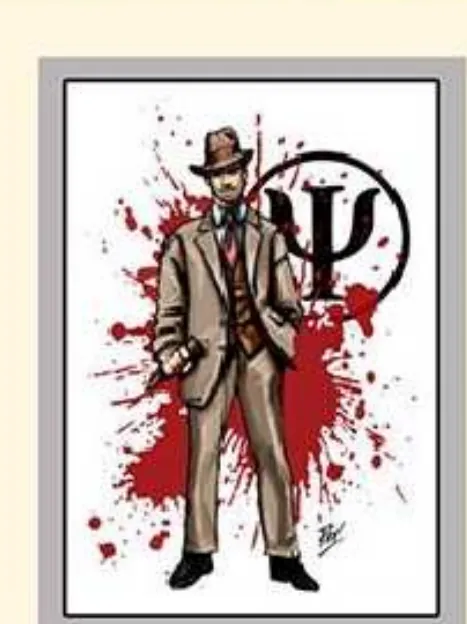

## Доктор Билл Робертсон, психолог, 42 года



```stat
СИЛ 55  ВЫН 60  ТЕЛ 55  ЛВК 60  ИНТ 75
НАР 60  МОЩ 70  ОБР 80  Рассудок 70  ПЗ 11
БкУ: нет  Комплекция: 0  Скорость: 8  Удача: 70  ПМ: 13

Бой
Драка      60% (30/12), урон 1d3
Пистолет   40% (20/8), урон по оружию
Винтовка   50% (25/10), урон по оружию
Уклонение  50%
```

*Прим. перев.: ПМ 13 — так в оригинале; при МОЩ 70 должно быть 14.*

### Навыки

Психология 75%, Психоанализ 70%, Убеждение 60%, Первая помощь 40%,
Оккультизм 20%, Скрытность 40%, Чтение следов 30%,
Средства 60%.

### Предыстория

**Описание:** Билл — обычный мужчина средних лет с каштановыми волосами. Костюм на нём старый и уже поношенный. Обычно он неопрятен и небрит.

Билл — военный в отставке; он приехал в Нью-Гэмпшир по следам одного дела. Умение отличать правду, высокая терпимость к неведомому и стремление к истине, какой бы она ни была и куда бы ни вела, делают его прирождённым исследователем паранормального.

Он слышал столько историй (включая историю Свена), что знает: что-то из этого должно быть правдой.

### Снаряжение

Блокнот и карандаш, 20 долларов наличными.

### Заметки игрока
