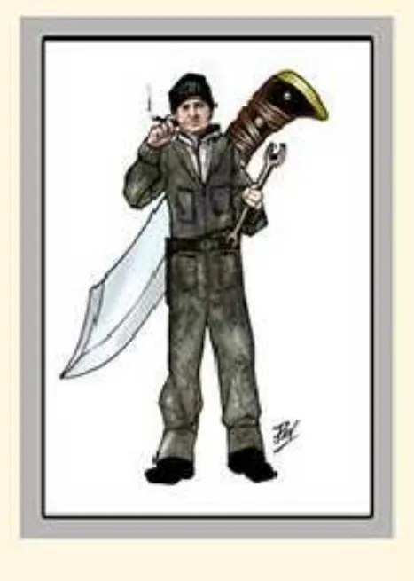

## Форалз Боуз, судовой механик, 45 лет



```stat
СИЛ 75  ВЫН 70  ТЕЛ 65  ЛВК 60  ИНТ 55
НАР 40  МОЩ 50  ОБР 40  Рассудок 50  ПЗ 13
БкУ: +1d4  Комплекция: 1  Скорость: 8  Удача: 50  ПМ: 10

Бой
Драка      65% (32/13), урон 1d3+БкУ
Нож        50% (25/10), урон 1d4+2+БкУ
Винтовка   45% (22/9), урон по оружию
Уклонение  30%
```

### Навыки

Ремесло (вязание узлов) 60%, Электрика 50%, Первая помощь 30%, Иностранный язык (французский) 35%,
(испанский) 30%, (итальянский) 40%, Механика 70%, Ориентирование 65%,
Управление тяжёлыми машинами 40%, Пилотирование (судно) 30%, Плавание 60%,
Средства 30%.

### Предыстория

**Описание:** Форалз обычно ходит в шерстяном свитере и грубых брюках или комбинезоне, а шерстяная шапка на нём всегда. Он коренаст, и при нём неизменная сигара.

Форалз — судовой инженер, начинавший корабелом под Глазго. Он прошёл весь путь учеником в чреве корабля. Тридцать лет спустя он сам выучил дюжину учеников и видел в море то, чего не должен видеть ни один человек. Пока его судно стоит в порту на ремонте корпуса, он решает, что, пожалуй, пора проверить кое-какие следы, собранные за эти годы.

### Снаряжение

5 сигар, зажигалка, сумка с инструментами, нож Боуи, 20 долларов наличными.

### Заметки игрока
