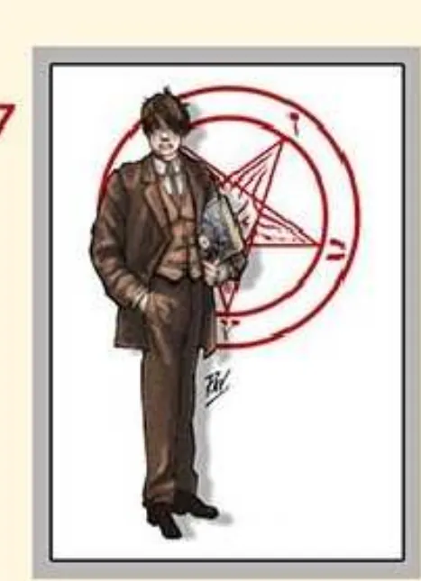

## Джейми Хэнкок, вольный исследователь, 27 лет



```stat
СИЛ 55  ВЫН 60  ТЕЛ 55  ЛВК 60  ИНТ 75
НАР 60  МОЩ 70  ОБР 70  Рассудок 70  ПЗ 11
БкУ: нет  Комплекция: 0  Скорость: 8  Удача: 70  ПМ: 14

Бой
Драка      55% (27/11), урон 1d3 (+1 с кастетами)
Пистолет   40% (20/8), урон по оружию
Уклонение  30%
```

### Навыки

Антропология 45%, Маскировка 30%, Оккультизм 40%, Внимание 50%, Работа в библиотеке 50%,
Иностранные языки (латынь) 45%, (арабский) 30%, (греческий) 40%, (французский) 35%, Красноречие 40%,
История 45%, Чтение следов 35%,
Средства 50%.

### Предыстория

**Описание:** Джейми носит твидовый жилет, и под мышкой у него всегда старая затхлая книга. Волосы у него растрёпаны, а вид обычно озабоченный.

Джейми учился в Мискатоникском университете, но за 5 лет так и не получил степень. За свои немногие годы он кое-что повидал и вечно сбегал разгадывать очередную загадку Аркхема. Учись он в другом городе и другом университете, его жизнь могла бы сложиться совсем иначе. Джейми вырос в южной части Бостона; у него два кастета, которые складываются в кельтский крест.

### Снаряжение

2 кастета, книга об оккультизме, 12 долларов наличными.

### Заметки игрока
