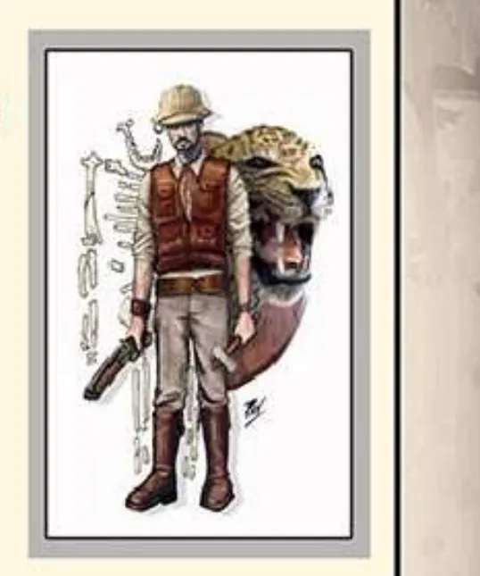

## Лорд Алестер Брэдли, профессор и охотник, 38 лет



```stat
СИЛ 60  ВЫН 70  ТЕЛ 55  ЛВК 80  ИНТ 75
НАР 60  МОЩ 60  ОБР 75  Рассудок 60  ПЗ 12
БкУ: нет  Комплекция: 0  Скорость: 9  Удача: 60  ПМ: 12

Бой
Драка      55% (27/11), урон 1d3
Винтовка   55% (27/11), урон по оружию
Дробовик   60% (30/12), урон по оружию
Уклонение  50%
```

### Навыки

Антропология 55%, Археология 60%, Лазание 50%, Вождение автомобиля 45%, Ориентирование 50%,
Иностранные языки (испанский) 40%, (португальский) 40%, Работа в библиотеке 60%, Естествознание 40%,
Внимание 55%, Выживание 35%,
Средства 70%.

### Предыстория

**Описание:** У Алестера тёмно-каштановые волосы, тонкие борода и усы. За годы под открытым небом он загорел. Алестер худощав, спортивного сложения.

Лорд Брэдли родился в богатстве, но тяга к приключениям в нём сильнее чувства долга. Он живёт в Англии и ездит по университетам всего мира с гостевыми лекциями. Двуствольный дробовик он обычно держит под рукой и легко отвлекается на приключения.

### Снаряжение

Двуствольный дробовик 12-го калибра, 10 патронов, урон 4d6/2d6/1d6.
Сумка с археологическими реликвиями из Южной Америки, конспекты лекций, 32 доллара наличными.

### Заметки игрока
