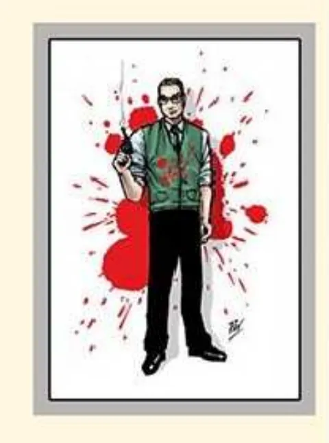

## Доктор Лукас Вандергон, врач, 31 год



```stat
СИЛ 60  ВЫН 50  ТЕЛ 50  ЛВК 75  ИНТ 80
НАР 50  МОЩ 70  ОБР 90  Рассудок 70  ПЗ 10
БкУ: нет  Комплекция: 0  Скорость: 9  Удача: 70  ПМ: 14

Бой
Драка      25% (12/5), урон 1d3
Пистолет   45% (22/9), урон по оружию
Уклонение  37%
```

### Навыки

Вождение автомобиля 40%, Первая помощь 60%, Иностранный язык (латынь) 60%, Работа в библиотеке 60%, Слух 45%,
Медицина 75%, Оккультизм 45%, Психоанализ 20%, Внимание 40%, Плавание 30%,
Средства 60%.

### Предыстория

**Описание:** Лукаса обычно можно застать в рубашке с закатанными рукавами, при галстуке и в чёрных брюках. Из-за худого, мелкого сложения голова у него кажется великоватой.

Доктор Вандергон родом из Нидерландов, где его лишили права практиковать за сомнительные исследования. Он перебрался в Новую Англию, чтобы продолжить исследования тёмных тайн мира.

### Снаряжение

Медицинская сумка, револьвер .38, 12 патронов, урон 1d10.
32 доллара наличными.

### Заметки игрока
