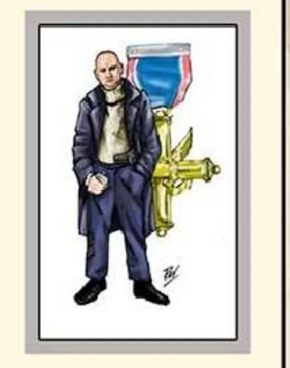

## Свен «Док» Берглоу, бродяга, 39 лет



```stat
СИЛ 65  ВЫН 70  ТЕЛ 70  ЛВК 60  ИНТ 60
НАР 40  МОЩ 60  ОБР 60  Рассудок 50  ПЗ 14
БкУ: +1d4  Комплекция: 1  Скорость: 7  Удача: 60  ПМ: 12

Бой
Драка      65% (32/13), урон 1d3+БкУ
Пистолет   60% (30/12), урон по оружию
Уклонение  50%
```

### Навыки

Первая помощь 70%, Взлом 50%, Медицина 30%, Ориентирование 40%, Оккультизм 30%,
Мифы Ктулху 5%, Внимание 55%, Скрытность 60%, Выживание 50%,
Средства 0%.

### Предыстория

**Описание:** Свен знавал лучшие дни. Он всё ещё носит флотский свитер, рабочие штаны и флотскую шинель. За последний год, живя на улицах Бостона, он сильно похудел.

Свен пошёл во флот, чтобы сбежать с семейной фермы, и стал санитаром. За несколько лет службы он дослужился до старшины. В 1918 году он руководил батальонным медпунктом за линией фронта, когда немцы выпустили тёмную молодь. Из 250 морских пехотинцев батальона выжили лишь 15. Свен был одним из этих пятнадцати, и выжившие обязаны жизнью в основном ему.

Флот на несколько месяцев отправил его в психиатрическое отделение, но Свен запил и так и не смог стряхнуть увиденный ужас. Он живёт на улицах Бостона и только теперь снова способен смотреть жизни в лицо. Он полон решимости понять ужасы, которые видел на войне.

### Снаряжение

Фляжка виски, автоматический пистолет .45, 4 патрона, урон 1d10+2.
1 доллар наличными.

### Заметки игрока
