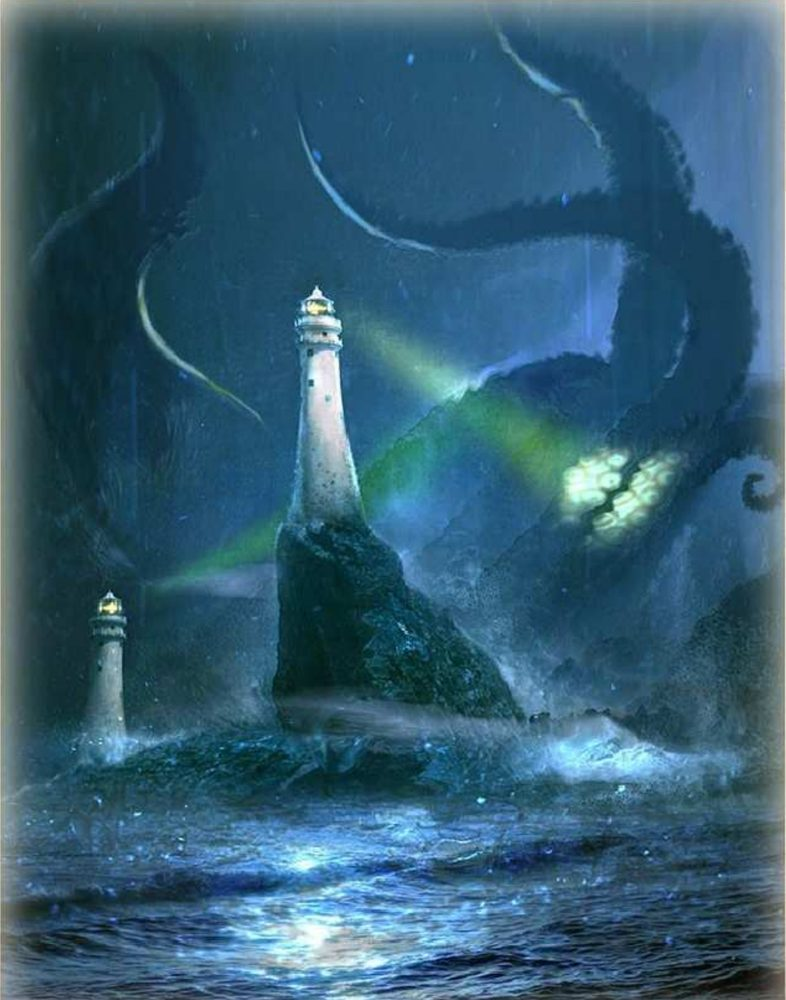

# Примечания и источники

1. http://iopscience.iop.org/article/10.1086/123109/pdf
2. https://vintagerockport.com/2011/12/18/woods-house-rockport-mass-circa-1920/
3. Пересказ по: https://vintagerockport.com/tag/witch-house/
4. Вдохновение и исторические факты: https://vintagerockport.com/
5. *N’gha nog ah lloig nglui n’ghft:* Смерть приходит к разуму на пороге тьмы.
6. *C’ai yorr’enyth nnn’nilgh’ri:* Мы велим нашему духу-слуге следить за всем.

