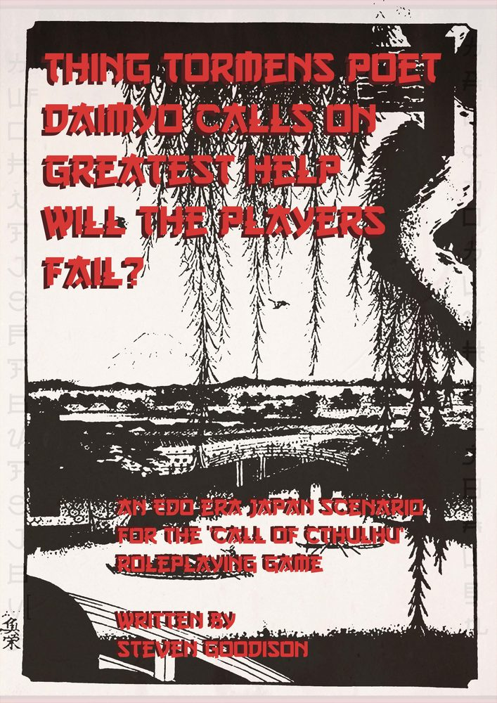

ТВАРЬ ТЕРЗАЕТ ПОЭТА, ДАЙМЁ ЗОВЁТ НА ПОМОЩЬ ЛУЧШИХ — ПРОВАЛЯТСЯ ЛИ ИГРОКИ?

Сценарий для ролевой игры «Зов Ктулху» о Японии эпохи Эдо

Автор — Стивен Гудисон

*На обложке — японская гравюра: ветви ивы над рекой, мост, далёкие горы; красными буквами — название «Thing Tormens Poet Daimyo Calls on Greatest Help Will the Players Fail?», ниже — «An Edo era Japan scenario for the ‘Call of Cthulhu’ roleplaying game» («Сценарий о Японии эпохи Эдо для ролевой игры „Зов Ктулху“») и «Written by Steven Goodison» («Автор — Стивен Гудисон»).*

*Прим. перев.: название в книге напечатано по-разному: на обложке — «Tormens» (вместо «Torments») и «Calls on», на титуле (с. 1) и в выходных данных — «Calls for». В переводе — одно название: «Тварь терзает поэта, даймё зовёт на помощь лучших — провалятся ли игроки?»*
