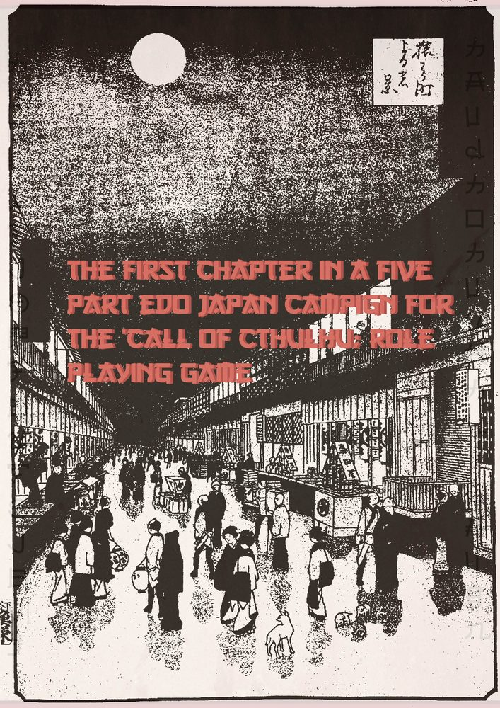

Первая глава кампании из пяти частей о Японии эпохи Эдо для ролевой игры «Зов Ктулху»

*На внутренней обложке — японская гравюра: ночная торговая улица под полной луной, лавки по обе стороны, прохожие и собака; поверх — красная надпись «The first chapter in a five part Edo Japan campign for the ‘Call of Cthulhu’ role playing game».*

*Прим. перев.: в надписи опечатка «campign» (вместо «campaign»). Вышла только эта, первая глава; остальные четыре не издавались.*
