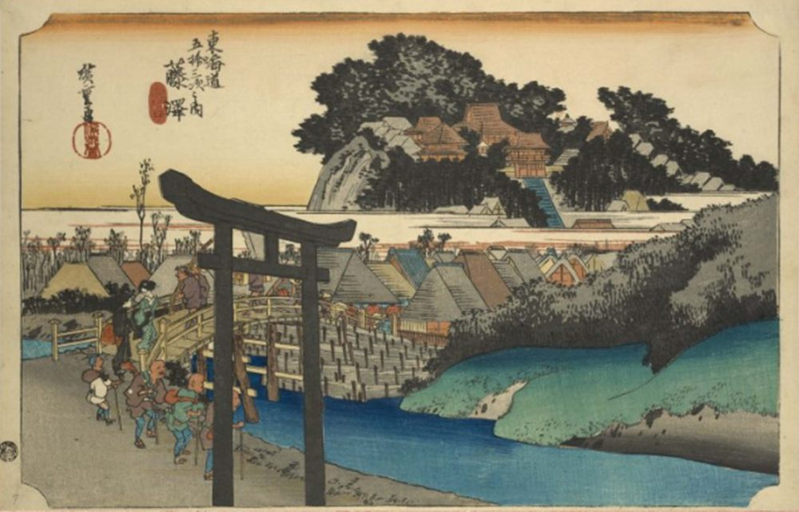

## Встреча Идайны Синдзина с Бракованным Старцем и распря со Старцами Ямагути

Это была ночь как ночь, когда *Идайна* отправился в горы за горными цветами. Бракованный Старец, впервые увидев своего кумира во плоти, подошёл к нему и по глупости показался ему на глаза — *Идайна* от потрясения упал в обморок. Не зная о болезни, которую носил в себе, Бракованный Старец заразил ею *Идайну*. Болезнь, которой заразился *Идайна*, действительно вызвал Бракованный Старец, но сыпь обратного отсчёта — на самом деле творение Старцев Ямагути. Теперь в *Идайну* вселился Бракованный Старец, способный говорить лишь отрезками по семь слогов, а также Старцы Ямагути, способные говорить лишь отрезками по пять. Старцы Ямагути создали сыпь обратного отсчёта, чтобы выманить Бракованного Старца на открытое место и убить его раз и навсегда, а если *Идайну* не исцелить, отсчёт его убьёт. Им нужна голубая кровь бракованного.

## Город Ямагути

В эпоху Эдо Ямагути — вполне почтенный город. Прямо через него течёт река Фусино, а с обеих сторон его обступают густые леса и невысокие горы, образуя что-то вроде котловины. Ямагути больше похож на тесное скопление городков, чем на один город. Прямо посреди города торчат две невысокие горы — гора Камэяма и гора Сёдзидакэ. Обе — любимые места прогулок и собирательства и крестьян, и знати.

Весть о внезапной болезни *Идайны* и его состоянии Ямагути почти не взволновала. Почти никто вне художественных и знатных кругов даже не знает, что он болен, да и не интересуется этим; жизнь идёт своим чередом. Ямагути лежит недалеко от прибрежного города Хофу и входит в речную систему Фусино, поэтому здесь много торгуют рыбой. Стоя на краю густых японских лесов, Ямагути слывёт опасным по ночам: проказливые лесные ёкаи покидают свои жилища, чтобы досаждать людям в соседнем городе.

## Храм Рурикодзи и встреча с даймё

Храм Рурикодзи — пятиярусный буддийский храм; его окружают высокие сосны, а летом — всевозможные цветы. *Идайна* постоянно здесь бывал, и храм вдохновил многие его стихи. Прямо у храма — небольшой пруд с множеством карпов кои. *Ямагути Хого* сидит в своём господском паланкине и не выходит из него; паланкин всё время окружают четыре самурая в тяжёлых доспехах. Даймё приглашает двоих сыщиков сесть к нему в паланкин и побеседовать.

*Ямагути Хого* — полноватый человек, выглядит невероятно усталым и всё время сжимает в руке бутылку сакэ. Он изо всех сил старается ободрить сыщиков, но проверка ***Психологии*** покажет, что он глубоко встревожен и тревога эта недавняя. Хого расскажет сыщикам то, что считает настоящей историей болезни Идайны и сыпи обратного отсчёта. Хого уверен, что болезнь наслал мононокэ (мстительный дух) недавно умершего хозяина игорного дома, *Донёкуны Тэ*: Идайна был ему должен, а *Хого* списал эти долги, ничего не заплатив. Он приказывает сыщикам либо умилостивить мнимого мононокэ, либо как-то иначе вылечить *Идайну*.

> **В эту пору японской истории носить оружие любого рода запрещалось всем, кто ниже самурая. Это не значит, что сыщики-не самураи никак не могут владеть оружием, но это невероятно маловероятно, и они не стали бы этого показывать: наказание за ношение оружия было любым — от конфискации до казни на месте.**

