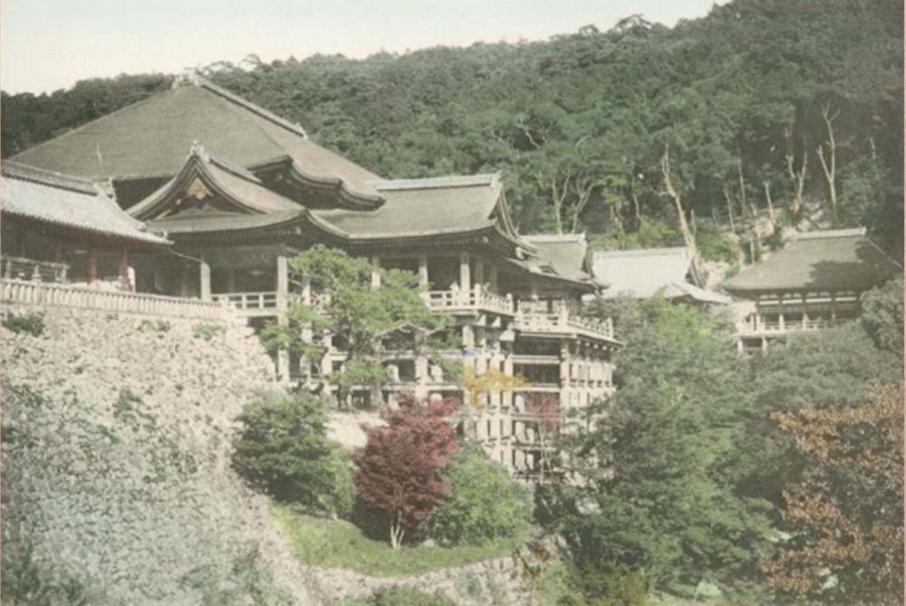

Он даёт сыщикам «пропускное письмо» с печатью Ямагути — оно открывает вход в большинство заведений, кроме самых упрямых. Напоследок *Хого* говорит, что всю следующую неделю занят официальным визитом даймё соседней провинции, так что обратиться к нему будет нельзя — сыщики предоставлены сами себе. Впрочем, пропускное письмо действует только в пределах города Ямагути.

Пока *Хого* беседует с сыщиками в паланкине, из храма с бранью выходят двое — *Курои Роху*, онмёдзи даймё (знаток оккультного), и *Юби Хира*, лекарь даймё. Они спорят друг с другом. Если сыщики не хотят их прерывать, при успешной проверке ***Слуха*** они услышат спор о том, духовное у *Идайны* состояние или телесное: *Курои* стоит за мононокэ, а *Юби* — за аллергию на цветы. Если сыщики их прервут, оба замолчат.

*Курои* — маленький худой человек с длинными сальными чёрными волосами, неразговорчивый и грубый с сыщиками. Проверка ***Внимания*** покажет, что у *Курои* при себе церемониальный кинжал, а на руке — странная татуировка. Если спросить о них, он спрячет и то и другое и скажет, что это не дело сыщиков. Успешная проверка ***Истории*** или ***Ближнего боя (меч)*** покажет, что кинжал чисто церемониальный, а успешная проверка ***Оккультизма*** — что татуировка изображает очень распространённую молитву об изгнании злых духов. *Юби* вежливее, но смотрит на сыщиков свысока, пока те не покажут, что тоже смыслят в медицине. Проверка ***Внимания*** покажет, что рука у *Юби* кривая. Если бестактно спросить об этом, *Юби* отчитает сыщиков за грубость, а *Курои* хихикнет. Успешная проверка ***Первой помощи*** или ***Медицины*** покажет, что это, скорее всего, неправильно сросшийся перелом.

Пара разговаривает с сыщиками, пока Хого не велит всем расходиться; тогда они следуют за паланкином *Хого*.

## Театр кабуки «Чёрная утка»

Театр кабуки «Чёрная утка» стоит в квартале развлечений Ямагути. Днём здесь запустение, но с заходом солнца квартал оживает. Со всех сторон театр кабуки «Чёрная утка» обступают питейные заведения и публичные дома, но он возвышается над всеми прочими дешёвыми театрами кабуки Ямагути. Пока те дают свои представления, труппа «Чёрной утки» показывает искусство высочайшей культуры.

«Чёрную утку» открыли в 1450 году по воле тогдашнего местного даймё, покровителя искусств. «Чёрная утка» прославилась тем, что здесь ставили первые спектакли многих драматургов, актёров и поэтов, которые потом сделали блестящую карьеру, — это придало театру ореол престижа. В какой-то момент «Чёрная утка» завела порядок, по которому в театре одновременно живут девять резидентов: три поэта, три драматурга и три актёра. У каждого — своя комната в «Чёрной утке»: считалось, что так им лучше работается, ведь они в буквальном смысле окружены своим искусством. Идайна Синдзин — лишь последний из этих резидентов.

Само здание «Чёрной утки» выглядит как передняя половина дома, выступающая на улицу. Снаружи — верёвка на шестах, что-то вроде порядка для очереди; здание целиком выкрашено в чёрный цвет с красными акцентами, на дереве вырезаны утки. Видимая снаружи часть здания — в три этажа, с плоской крышей. Если сыщики приходят днём, дверь закрыта, на ней записка: *«Закрыто. По серьёзным делам — входите и объяснитесь»*.

Снаружи несколько работников развешивают украшения к премьере новой пьесы, которая открывается этим вечером. Успешная проверка ***Внимания*** покажет, что буквально все украшения — какого-то оттенка жёлтого. Образы украшений совершенно чужды всем японским сыщикам, но сыщики-европейцы или сыщик, прошедший проверку ***Чужих стран***, поймут, что сюжет пьесы определённо европейский. Успешная проверка ***Истории*** с этим знанием покажет, что сюжет относится к раннему Средневековью. Кроме этого, о пьесе сыщикам ничего не известно. Если спросить, никто из работников не может вспомнить настоящее название пьесы — её называют просто *«Странным представлением гайдзинов»*. Входная дверь не заперта, и сыщики могут войти.

Если же сыщики приходят ночью, вся округа запружена десятками и десятками зрителей, ждущих премьеры совершенно новой пьесы под названием *«Химавари ни ми о цуцунда ёроппа но дзёги»*. Теперь театр кабуки как следует увешан этими жёлтыми украшениями — от драпировок до цветов. Даже просто войти в здание стоит 100 иен, а привлечь внимание работников «Чёрной утки» куда труднее: все они очень заняты спектаклем.

*Прим. перев.: в оригинале навык «Foreign nations» — в правилах 7-й редакции такого навыка нет; переведено как «Чужие страны», как в записях базы. Иены в 1679 году ещё не существовало — анахронизм книги; суммы оставлены как напечатаны.*

