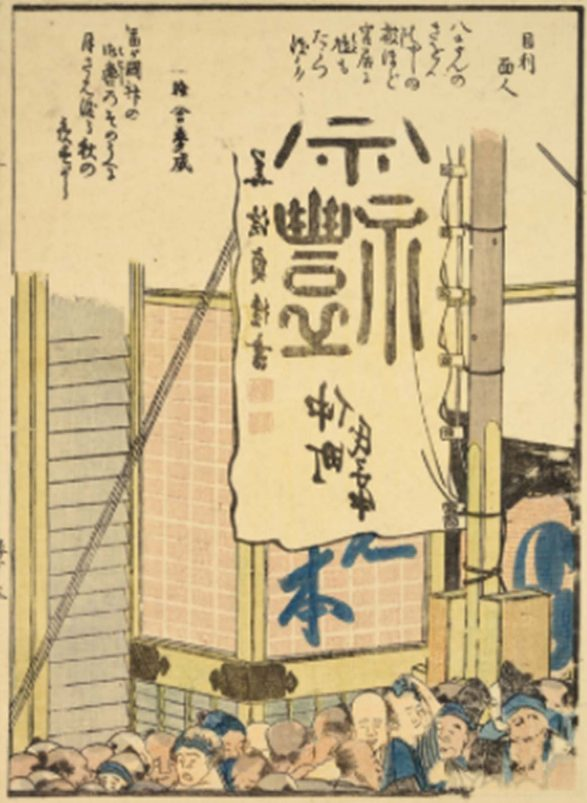

## Закулисье театра кабуки и подвал

Днём закулисье служит швейной мастерской и актёрской студией. Здесь поровну актёров, которые разучивают реплики и согласованные движения, и швей, которые собирают всевозможные наряды. Закулисье тянется на все три этажа: ярус за ярусом — закройщики, танцоры массовки и декораторы. Никто из них не обращает внимания на сыщиков, если те не мешают работе, — все слишком заняты. Здесь невероятно душно, и за каждый час, проведённый за кулисами, каждый сыщик должен пройти проверку ***ВЫН***, иначе получит ***1 ПЗ*** урона, надышавшись дымом.

Закулисье соединено с подвалом. Когда дверь в подвал закрывается, оглушительный шум закулисья перестаёт проникать внутрь — здесь полная тишина. В подвале есть только мягко освещённая статуя в дальнем конце, окружённая зажжёнными свечами и благовониями. Статуя изображает полную приземистую женщину с восемью руками, сидящую в цветке лотоса. Сыщики-буддисты узнают в ней статую *Бэндзайтэн*, богини текущих слов и мысли; остальным для этого нужна успешная проверка ***Оккультизма*** или ***Истории***. У её ног — бесчисленные подношения: рис, монеты и сладкие пирожки. Если сыщик возьмёт что-нибудь из подношений, он *1d4* часа не может тратить Удачу, сам того не зная. Если сыщик-буддист помолится *Бэндзайтэн* или иначе сделает ей подношение, то *1d4* часа все его трудные успехи в проверках Красноречия, Убеждения, Запугивания и Обаяния считаются чрезвычайными — тоже без его ведома.

## Идайна Синдзин и его комната

*Идайна* живёт на втором этаже театра кабуки «Чёрная утка», в комнате 3 жилых покоев резидентов. У двери его комнаты всё время стоит самурай-стражник: он пустит сыщиков, только если им покажут печать даймё или иное явное разрешение. Комната *Идайны* — маленькая, прямоугольная, пахнет потом и немытым телом; по ней разбросана бумага, часть листов скомкана, часть забрызгана кровью. Окон нет, в комнате совсем темно: *Идайне* нельзя доверить открытый огонь, даже свечу. Успешная проверка ***Внимания*** в комнате покажет, что здесь нет ни одного острого предмета, и даже постель набита гуще обычного. Ещё в комнате много ваз с цветами. Проверка ***Естествознания*** покажет, что цветы собраны со всей Японии, а некоторые сыщику вообще незнакомы. Успешная проверка ***Чужих стран*** покажет, что в его собрании есть и несколько европейских растений.

Благоразумно заранее написать несколько хайку — или Хранителю нужно очень хорошо импровизировать: *Идайну Синдзина* играть трудно, ведь в него одновременно вселились и Бракованный Старец, и небракованные Старцы, и всё, что видит и переживает *Идайна*, видят и переживают они. *Идайна Синдзин* всё время находится в своей комнате. Идайна целиком потерян в себе и говорит только хайку: первая и третья строки хайку — голос одного из Старцев, вторая — голос Бракованного Старца.

*Идайна Синдзин* — молодой человек, невероятно худой, едва прикрытый одеждой. Кисти и предплечья у него в чернилах, а зрачки такие бледные, что кажутся почти белыми. Сыщики теряют *1d4* Рассудка, увидев *Идайну Синдзина*. Когда он говорит, изо рта у него текут сопли и мокрота. Успешная проверка ***Медицины*** покажет, что у *Идайны* какая-то инфекция. *Идайна* не замечает сыщиков, пока к нему не обратятся. Успешная проверка ***Оккультизма*** покажет: подобное состояние описано во многих легендах, но точно не совпадает ни с одной. На груди у *Идайны* — сыпь обратного отсчёта в виде кандзи числа 3. Успешная проверка ***Первой помощи*** никак не поможет от сыпи, но успешная проверка ***Медицины*** или ***Естествознания*** покажет, что сыпь похожа на кожную, какая бывает от прикосновения к некоторым растениям. Каждый день сыпь будет отсчитывать на единицу меньше, до 0.

Первый голос требует смерти *«нападавшего»* или *«испорченного»* и велит *«положить его у святилища на Сёдзидакэ»*. Второй голос невероятно виноватый, почти детский: он умоляет и упрашивает, твердит, что ему жаль, — и больше ничего не говорит. Первый же голос холоден и умён. Успешная проверка ***Психологии*** покажет, что это две явно разные личности.

Успешная проверка ***Психоанализа*** покажет, что оба голоса точно не принадлежат *Идайне Синдзину*. Успешная проверка ***Оккультизма*** покажет, что это одержимость. На вопросы о том, кто они такие, первый голос не отвечает, — говорит лишь, что хочет смерти *«нападавшего»*, но не скажет, кто или что этот нападавший. Если сыщики продолжат расспрашивать Идайну *1d4+10* минут, первый голос выйдет из себя, заставит Идайну вонзить отросшие ногти себе в шею до крови и потребует: либо сыщики найдут и убьют *«нападавшего»*, либо он убьёт *Идайну* прямо сейчас. Если сыщики не выйдут из комнаты в течение минуты, первый голос убьёт *Идайну*, и сценарий будет проигран.

> *Изначально кабуки был чисто женским искусством, но в начале эпохи Эдо закон разрешил играть в театре кабуки только мужчинам. Поэтому, как и в европейском театре того времени, для женских ролей мужчины гримировались и надевали женскую одежду. Правительство Эдо это вполне дозволяло.*
>
> *Если вы как Хранитель решите ввести и актрис, на сценарий это не повлияет, но ради исторической точности: актрис в кабуки не было.*

*Прим. перев.: навык «Natural world» в оригинале — «Естествознание» (Natural World) русской Книги хранителя; «Foreign nations» — см. примечание на с. 3.*
