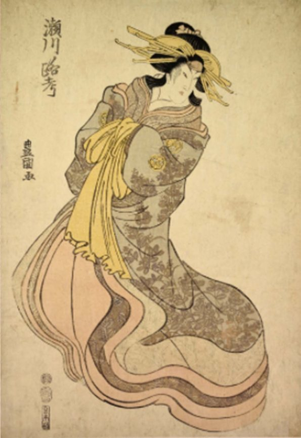
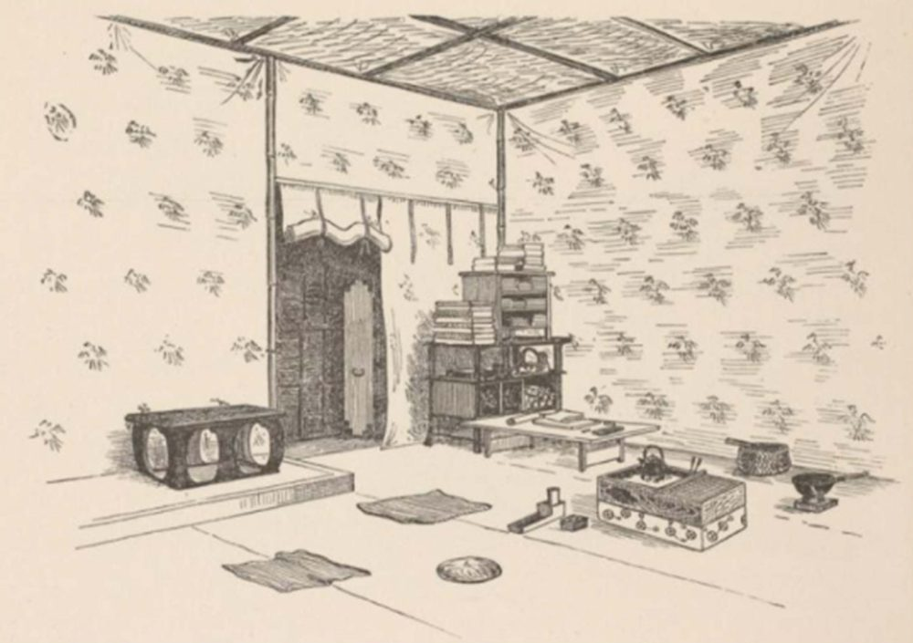

## Хозяин театра и его кабинет

Хозяин и директор «Чёрной утки» — неуживчивый жилистый человек по имени *Гэйдзюцу Тэки*. Болезнь *Идайны* его страшно раздражает, сочувствия к поэту у него нет: он уверен, что тот просто притворяется. Кроме того, его гнетёт, что он должен игорному дому «Беторозу» много денег — ровно 3054 иены. Днём он сидит в фойе «Чёрной утки» и сразу же спрашивает сыщиков, зачем они пришли. Какую причину сыщики назовут, желая увидеть *Идайну*, на самом деле неважно: *Гэйдзюцу* так мало до него дела, что он даже пошутит — будь сыщики хоть ниндзя-убийцами, ему всё равно. Закончив разговор с сыщиками, *Гэйдзюцу* весь день проводит за кулисами и только в 4 часа дня уходит в свой кабинет наскоро пообедать в одиночестве.

Кабинет *Гэйдзюцу* находится на третьем этаже — это единственная комната третьего этажа, и она всегда открыта: таковы уж заносчивость и беспечность *Гэйдзюцу*. Это жалкий маленький кабинет почти без мебели. Впрочем, у него есть небольшой стол, и успешная проверка ***Работы в библиотеке*** даст сыщику записку. Успешная проверка ***Внимания*** в самой комнате покажет торчащую из стены верёвочку. Если за неё потянуть, откроется маленький тайник с бутылками сакэ и ещё одной бумагой — страховым полисом, по которому в случае смерти *Идайны Синдзина* выплачивается 10 000 иен. Если эта бумага пропадёт, *Гэйдзюцу* до конца сценария будет в панике.

*Прим. перев.: в тексте полис на 10 000 иен, а на раздатке «Страховой полис» (с. 24) — на 3000 иен. Что написано в первой «записке» на столе, книга не говорит. Кабинет назван единственной комнатой третьего этажа, но на плане он нарисован на втором этаже (с. 20).*

## Таинственная пьеса

Всё время, пока сыщики находятся в театре кабуки «Чёрная утка», они будут слышать о таинственной новой пьесе, премьера которой — этим же вечером. О ней мимоходом говорят работники «Чёрной утки», а Гэйдзюцу Тэки спросит, не хотят ли сыщики посмотреть пьесу по сниженной цене — за 70 иен. Если сыщики решат пойти на пьесу, им скажут, что она начнётся в 22:00 и продлится до 2 часов ночи и что называется она «Химавари ни ми о цуцунда ёроппа но дзёги». Вот что увидят сыщики:

> *«Начинается пьеса кабуки. Музыка незнакома. Даже тем, кто уже видел театр кабуки, всё кажется невероятно необычным. Актёры в белых масках с длинными носами весь спектакль говорят со странным акцентом. Костюмы меньше, чем в других пьесах, а один актёр в интерлюдиях всё время поёт. В пьесе есть актёр в белой маске без черт лица и в огромном жёлтом кимоно. К концу пьесы он убивает всех остальных актёров; пьеса заканчивается песней, которую выкрикивает певец интерлюдий. Ни хлопков, ни возгласов, ни слёз — лишь тишина: весь зал опустошён этим странным переживанием, актёры уходят со сцены и оставляют зрителей в темноте смотреть на пустую сцену».*

Сыщики уходят со спектакля совершенно опустошёнными и теряют *1d6* Рассудка от пережитого. Если после спектакля спросить *Гэйдзюцу Тэки*, кто написал пьесу, он охотно отведёт сыщиков в комнату драматурга. Комната совершенно пуста, окно открыто.

*Прим. перев.: в оригинале — «one actor keeps signing at interludes» (видимо, «singing» — «поёт»). Дальше книга этот след не продолжает.*

